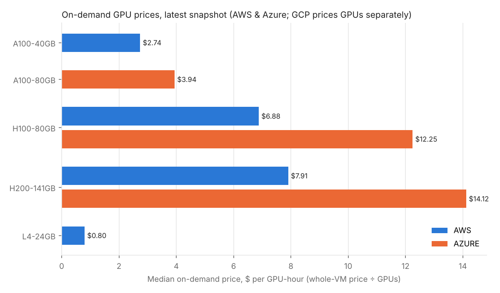
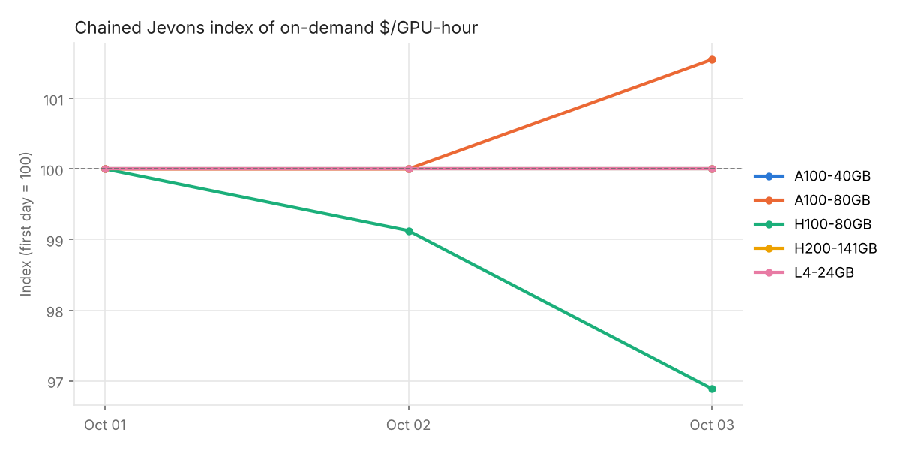

# Compute Price Indices

A daily dataset of **public cloud GPU prices**, cleaned and normalized to a single comparable unit: **US dollars per GPU-hour**.

Compute is becoming one of the most important inputs in the economy, but its price is surprisingly hard to observe. Every provider publishes a price list, and none of them are comparable out of the box: they price whole machines with different GPU counts, mix in OS licenses and discount programs, use different units and formats, and quietly add, change and delist products. This project collects those public price lists every day, normalizes them, checks them for data problems, and builds a price index that isn't fooled by products appearing and disappearing.

## What it does

```
collect ──▶ raw/          untouched API responses, one folder per day
build   ──▶ clean/        normalized quotes + a log of everything filtered out
validate──▶ issues.csv    data-quality checks (errors, warnings, info)
report  ──▶ reports/      summary tables, spot discounts, price index, charts
```

| Provider | Source | Auth |
|---|---|---|
| Azure | [Retail Prices API](https://learn.microsoft.com/en-us/rest/api/cost-management/retail-prices/azure-retail-prices) | none |
| AWS | Price List Query API (`boto3` `pricing.get_products`) | any AWS credentials (free) |
| GCP | Cloud Billing Catalog API | free API key |

A GitHub Action runs the pipeline daily and commits the snapshot back to the repo, so the git history doubles as an audit trail for every price.

## Quick start

```bash
pip install -e ".[dev]"

# Run the whole pipeline on the bundled synthetic fixtures (no network or keys needed)
gpu-prices demo
open demo_output/reports/README.md

# Collect real data (Azure needs no credentials)
gpu-prices run --providers azure
pip install -e ".[aws]" && gpu-prices run --providers azure,aws    # with AWS credentials configured
GCP_API_KEY=... gpu-prices run --providers azure,aws,gcp

pytest
```

Example output from the demo. **These charts use synthetic fixture data, not real prices.**

<p>


</p>

## Cleaning: what gets filtered and why

Raw price lists contain far more than "the price of a GPU." Every filtered record is counted by reason in `clean/rejections.csv`, so cleaning is never silent. A sudden spike in `instance_not_in_catalog` means a provider launched new hardware; a spike in `unparseable_description` means a provider changed a format.

| Reason | Why it's excluded |
|---|---|
| `windows_license_included` | Windows prices bundle an OS license; only Linux is compared |
| `price_type_devtestconsumption` | Azure Dev/Test discount, only available to some subscriptions |
| `price_type_reservation` | Priced per 1- or 3-year term, not per hour |
| `cloud_services_product` | The same Azure VM sold through a legacy product: a duplicate quote |
| `low_priority_batch` | Legacy Azure Batch tier, superseded by Spot |
| `tenancy_dedicated` | AWS dedicated hosts have a different pricing model |
| `non_region_location` | AWS Local Zones and Wavelength price differently from regions |
| `capacity_reservation_line` | AWS billing line items for reserved capacity |
| `commitment_or_other_usage_type` | GCP committed-use pricing |
| `special_pricing_program` | GCP DWS, calendar mode and similar programs |
| `unsupported_gpu_model` | Older GPUs (T4, V100…) outside the tracked set |
| `non_hourly_unit`, `non_usd_currency`, `tiered_rate` | Not comparable without conversion assumptions |
| `instance_not_in_catalog` | No known GPU count, so no per-GPU price |

### The catalog

Prices are quoted per *instance*, and instances hold different numbers of GPUs (an AWS `p5.48xlarge` has 8 H100s). To get a per-GPU price the pipeline needs each instance's GPU count, and providers don't expose it consistently (Azure's API has nothing). [`gpu_catalog.csv`](src/gpu_prices/gpu_catalog.csv) is a small hand-maintained mapping that is reviewable in git. When AWS *does* report a count, the pipeline cross-checks it against the catalog and flags disagreements.

### Comparability: `price_basis`

AWS and Azure sell whole VMs, so their per-GPU price includes CPU, RAM and networking (`instance`). GCP publishes GPU-only line items with the VM billed separately (`accelerator_only`). These are tagged and never mixed in the same comparison or outlier group.

## Data-quality checks

Checks never change the data; they report to `clean/issues.csv`.

| Check | Severity | Catches |
|---|---|---|
| `non_positive_price` | error | Zero or missing prices (these appear in real price lists) |
| `conflicting_duplicate` | error | The same quote listed twice with different prices |
| `spot_at_or_above_on_demand` | error | Spot priced at or above on-demand for the same instance |
| `gpu_count_mismatch` | warning | Vendor metadata disagrees with the catalog |
| `price_outlier` | warning | Modified z-score of log $/GPU-hour > 3.5 within comparable quotes |
| `large_price_change` | warning | A series moved more than ±30% since its previous snapshot |
| `series_disappeared` | info | A quote listed yesterday is missing today |

**Outliers** use a modified z-score (median and MAD) on *log* prices. Logs because price errors are multiplicative: a 10× typo and a 1/10× typo should be equally far from the median. Median/MAD instead of mean/std so the outliers being hunted can't drag the baseline toward themselves. The MAD has a floor of 0.10, because price lists often contain several identical quotes, which can shrink the MAD to almost nothing and turn ordinary regional differences into false alarms.

## The price index

A naive index (the median price each day) is biased by **composition changes**: if the most expensive region stops being listed, the median falls even though no price changed.

The report uses a **chained Jevons index**, the method statistical agencies use for elementary price indices. Each day is compared only with the series that exist on both that day and the previous one, using the geometric mean of their price ratios:

$$I_t = I_{t-1} \cdot \exp\Big(\tfrac{1}{n}\sum_{i \in \text{matched}} \ln \tfrac{p_{i,t}}{p_{i,t-1}}\Big), \qquad I_0 = 100$$

The demo fixtures include exactly this situation: the most expensive H100 region is delisted on day 3, and the naive median index falls about 17%, far overstating the roughly 3% real price decline that the chained index measures.

## Project layout

```
src/gpu_prices/
  collectors.py    download raw price lists
  normalize.py     raw → common schema, with rejection reasons
  catalog.py       instance → GPU model/count mapping
  validate.py      data-quality checks
  analyze.py       summaries and the chained index
  report.py        markdown report + charts
  cli.py           gpu-prices {collect,build,validate,report,run,demo}
tests/
  fixtures/        SYNTHETIC raw snapshots shaped like real API responses
```

## Limitations

- **List prices only.** Large buyers negotiate discounts, and the spot market moves intraday. These are public retail prices sampled once a day.
- **Spot coverage** is Azure and GCP only. AWS spot prices come from a different API (`DescribeSpotPriceHistory`) that isn't wired in yet.
- **Hyperscalers only.** Specialized GPU clouds (Lambda, CoreWeave, RunPod and others) are often much cheaper and would be a valuable next source.
- The catalog has to be updated by hand when new instance types launch, though the rejection log makes that visible.

## Data and terms

All data comes from providers' official, publicly documented pricing APIs. Prices are each provider's published list prices and may be out of date; check the provider before relying on any number. This project is independent and not affiliated with any cloud provider.
