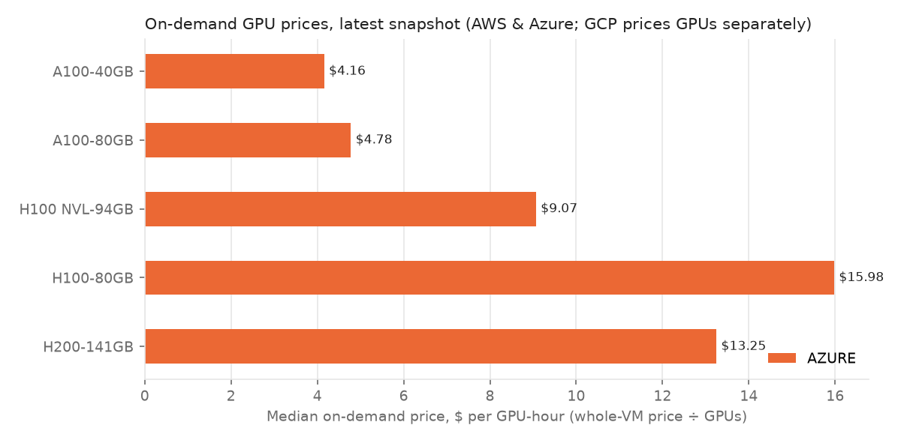
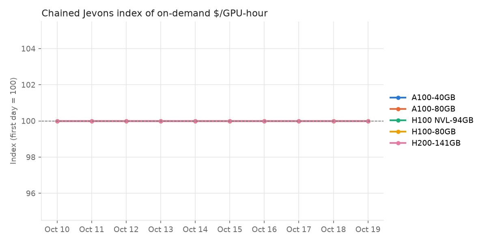

# GPU price report

Latest snapshot: **2026-10-19** · 10 snapshot(s) since 2026-10-10 · 448 quotes today.

## On-demand price per GPU-hour

`instance` = whole-VM price divided by GPU count (includes CPU, RAM, networking). `accelerator_only` = GCP's GPU line item, which excludes the VM it's attached to, so it reads lower and **is not directly comparable**.

| gpu_class | provider | price_basis | regions | min | median | max |
|---|---|---|---|---|---|---|
| A100-40GB | azure | instance | 6 | 3.4 | 4.16 | 4.42 |
| A100-80GB | azure | instance | 37 | 3.67 | 4.78 | 8.19 |
| H100 NVL-94GB | azure | instance | 29 | 6.98 | 9.07 | 10.12 |
| H100-80GB | azure | instance | 24 | 12.29 | 15.98 | 23.33 |
| H200-141GB | azure | instance | 31 | 10.6 | 13.25 | 21.2 |

## Spot discount vs on-demand

| gpu_class | provider | pairs | median_discount_pct |
|---|---|---|---|
| A100-40GB | azure | 6 | 78.3 |
| A100-80GB | azure | 104 | 81.5 |
| H100 NVL-94GB | azure | 54 | 81.1 |
| H100-80GB | azure | 24 | 81.5 |
| H200-141GB | azure | 31 | 0.0 |

## Price index

**A100-40GB**

| snapshot_date | quotes | matched_quotes | median_price | chained_index | median_index |
|---|---|---|---|---|---|
| 2026-10-10 | 6 | 0 | 4.16 | 100.0 | 100.0 |
| 2026-10-11 | 6 | 6 | 4.16 | 100.0 | 100.0 |
| 2026-10-12 | 6 | 6 | 4.16 | 100.0 | 100.0 |
| 2026-10-13 | 6 | 6 | 4.16 | 100.0 | 100.0 |
| 2026-10-14 | 6 | 6 | 4.16 | 100.0 | 100.0 |
| 2026-10-15 | 6 | 6 | 4.16 | 100.0 | 100.0 |
| 2026-10-16 | 6 | 6 | 4.16 | 100.0 | 100.0 |
| 2026-10-17 | 6 | 6 | 4.16 | 100.0 | 100.0 |
| 2026-10-18 | 6 | 6 | 4.16 | 100.0 | 100.0 |
| 2026-10-19 | 6 | 6 | 4.16 | 100.0 | 100.0 |

**A100-80GB**

| snapshot_date | quotes | matched_quotes | median_price | chained_index | median_index |
|---|---|---|---|---|---|
| 2026-10-10 | 110 | 0 | 4.78 | 100.0 | 100.0 |
| 2026-10-11 | 110 | 110 | 4.78 | 100.0 | 100.0 |
| 2026-10-12 | 110 | 110 | 4.78 | 100.0 | 100.0 |
| 2026-10-13 | 110 | 110 | 4.78 | 100.0 | 100.0 |
| 2026-10-14 | 110 | 110 | 4.78 | 100.0 | 100.0 |
| 2026-10-15 | 110 | 110 | 4.78 | 100.0 | 100.0 |
| 2026-10-16 | 110 | 110 | 4.78 | 100.0 | 100.0 |
| 2026-10-17 | 110 | 110 | 4.78 | 100.0 | 100.0 |
| 2026-10-18 | 110 | 110 | 4.78 | 100.0 | 100.0 |
| 2026-10-19 | 110 | 110 | 4.78 | 100.0 | 100.0 |

**H100 NVL-94GB**

| snapshot_date | quotes | matched_quotes | median_price | chained_index | median_index |
|---|---|---|---|---|---|
| 2026-10-10 | 58 | 0 | 9.07 | 100.0 | 100.0 |
| 2026-10-11 | 58 | 58 | 9.07 | 100.0 | 100.0 |
| 2026-10-12 | 58 | 58 | 9.07 | 100.0 | 100.0 |
| 2026-10-13 | 58 | 58 | 9.07 | 100.0 | 100.0 |
| 2026-10-14 | 58 | 58 | 9.07 | 100.0 | 100.0 |
| 2026-10-15 | 58 | 58 | 9.07 | 100.0 | 100.0 |
| 2026-10-16 | 58 | 58 | 9.07 | 100.0 | 100.0 |
| 2026-10-17 | 58 | 58 | 9.07 | 100.0 | 100.0 |
| 2026-10-18 | 58 | 58 | 9.07 | 100.0 | 100.0 |
| 2026-10-19 | 58 | 58 | 9.07 | 100.0 | 100.0 |

**H100-80GB**

| snapshot_date | quotes | matched_quotes | median_price | chained_index | median_index |
|---|---|---|---|---|---|
| 2026-10-10 | 24 | 0 | 15.98 | 100.0 | 100.0 |
| 2026-10-11 | 24 | 24 | 15.98 | 100.0 | 100.0 |
| 2026-10-12 | 24 | 24 | 15.98 | 100.0 | 100.0 |
| 2026-10-13 | 24 | 24 | 15.98 | 100.0 | 100.0 |
| 2026-10-14 | 24 | 24 | 15.98 | 100.0 | 100.0 |
| 2026-10-15 | 24 | 24 | 15.98 | 100.0 | 100.0 |
| 2026-10-16 | 24 | 24 | 15.98 | 100.0 | 100.0 |
| 2026-10-17 | 24 | 24 | 15.98 | 100.0 | 100.0 |
| 2026-10-18 | 24 | 24 | 15.98 | 100.0 | 100.0 |
| 2026-10-19 | 24 | 24 | 15.98 | 100.0 | 100.0 |

**H200-141GB**

| snapshot_date | quotes | matched_quotes | median_price | chained_index | median_index |
|---|---|---|---|---|---|
| 2026-10-10 | 31 | 0 | 13.25 | 100.0 | 100.0 |
| 2026-10-11 | 31 | 31 | 13.25 | 100.0 | 100.0 |
| 2026-10-12 | 31 | 31 | 13.25 | 100.0 | 100.0 |
| 2026-10-13 | 31 | 31 | 13.25 | 100.0 | 100.0 |
| 2026-10-14 | 31 | 31 | 13.25 | 100.0 | 100.0 |
| 2026-10-15 | 31 | 31 | 13.25 | 100.0 | 100.0 |
| 2026-10-16 | 31 | 31 | 13.25 | 100.0 | 100.0 |
| 2026-10-17 | 31 | 31 | 13.25 | 100.0 | 100.0 |
| 2026-10-18 | 31 | 31 | 13.25 | 100.0 | 100.0 |
| 2026-10-19 | 31 | 31 | 13.25 | 100.0 | 100.0 |

## Data quality

| severity | check | count |
|---|---|---|
| error | spot_at_or_above_on_demand | 310 |
| warning | price_outlier | 220 |

All issues

| check | severity | snapshot_date | provider | region | instance_type | pricing_model | detail |
|---|---|---|---|---|---|---|---|
| spot_at_or_above_on_demand | error | 2026-10-10 | azure | australiaeast | Standard_ND96isr_H200_v5 | spot | spot $122.96 vs on-demand $122.96 |
| spot_at_or_above_on_demand | error | 2026-10-10 | azure | australiasoutheast | Standard_ND96isr_H200_v5 | spot | spot $110.24 vs on-demand $110.24 |
| spot_at_or_above_on_demand | error | 2026-10-10 | azure | brazilsouth | Standard_ND96isr_H200_v5 | spot | spot $169.6 vs on-demand $169.6 |
| spot_at_or_above_on_demand | error | 2026-10-10 | azure | centralus | Standard_ND96isr_H200_v5 | spot | spot $95.824 vs on-demand $95.824 |
| spot_at_or_above_on_demand | error | 2026-10-10 | azure | eastus2 | Standard_ND96isr_H200_v5 | spot | spot $84.8 vs on-demand $84.8 |
| spot_at_or_above_on_demand | error | 2026-10-10 | azure | francecentral | Standard_ND96isr_H200_v5 | spot | spot $106.0 vs on-demand $106.0 |
| spot_at_or_above_on_demand | error | 2026-10-10 | azure | germanywestcentral | Standard_ND96isr_H200_v5 | spot | spot $110.24 vs on-demand $110.24 |
| spot_at_or_above_on_demand | error | 2026-10-10 | azure | indonesiacentral | Standard_ND96isr_H200_v5 | spot | spot $99.216 vs on-demand $99.216 |
| spot_at_or_above_on_demand | error | 2026-10-10 | azure | italynorth | Standard_ND96isr_H200_v5 | spot | spot $110.24 vs on-demand $110.24 |
| spot_at_or_above_on_demand | error | 2026-10-10 | azure | japaneast | Standard_ND96isr_H200_v5 | spot | spot $106.0 vs on-demand $106.0 |
| spot_at_or_above_on_demand | error | 2026-10-10 | azure | japanwest | Standard_ND96isr_H200_v5 | spot | spot $131.44 vs on-demand $131.44 |
| spot_at_or_above_on_demand | error | 2026-10-10 | azure | koreasouth | Standard_ND96isr_H200_v5 | spot | spot $106.0 vs on-demand $106.0 |
| spot_at_or_above_on_demand | error | 2026-10-10 | azure | malaysiawest | Standard_ND96isr_H200_v5 | spot | spot $99.216 vs on-demand $99.216 |
| spot_at_or_above_on_demand | error | 2026-10-10 | azure | mexicocentral | Standard_ND96isr_H200_v5 | spot | spot $93.28 vs on-demand $93.28 |
| spot_at_or_above_on_demand | error | 2026-10-10 | azure | northcentralus | Standard_ND96isr_H200_v5 | spot | spot $101.76 vs on-demand $101.76 |
| spot_at_or_above_on_demand | error | 2026-10-10 | azure | northeurope | Standard_ND96isr_H200_v5 | spot | spot $101.76 vs on-demand $101.76 |
| spot_at_or_above_on_demand | error | 2026-10-10 | azure | norwayeast | Standard_ND96isr_H200_v5 | spot | spot $121.264 vs on-demand $121.264 |
| spot_at_or_above_on_demand | error | 2026-10-10 | azure | polandcentral | Standard_ND96isr_H200_v5 | spot | spot $130.592 vs on-demand $130.592 |
| spot_at_or_above_on_demand | error | 2026-10-10 | azure | southafricanorth | Standard_ND96isr_H200_v5 | spot | spot $123.808 vs on-demand $123.808 |
| spot_at_or_above_on_demand | error | 2026-10-10 | azure | southcentralus2 | Standard_ND96isr_H200_v5 | spot | spot $93.28 vs on-demand $93.28 |
| spot_at_or_above_on_demand | error | 2026-10-10 | azure | southeastasia | Standard_ND96isr_H200_v5 | spot | spot $110.24 vs on-demand $110.24 |
| spot_at_or_above_on_demand | error | 2026-10-10 | azure | spaincentral | Standard_ND96isr_H200_v5 | spot | spot $110.24 vs on-demand $110.24 |
| spot_at_or_above_on_demand | error | 2026-10-10 | azure | swedencentral | Standard_ND96isr_H200_v5 | spot | spot $110.272 vs on-demand $110.272 |
| spot_at_or_above_on_demand | error | 2026-10-10 | azure | uaenorth | Standard_ND96isr_H200_v5 | spot | spot $121.264 vs on-demand $121.264 |
| spot_at_or_above_on_demand | error | 2026-10-10 | azure | uksouth | Standard_ND96isr_H200_v5 | spot | spot $106.0 vs on-demand $106.0 |
| spot_at_or_above_on_demand | error | 2026-10-10 | azure | ukwest | Standard_ND96isr_H200_v5 | spot | spot $111.088 vs on-demand $111.088 |
| spot_at_or_above_on_demand | error | 2026-10-10 | azure | usgovarizona | Standard_ND96isr_H200_v5 | spot | spot $106.0 vs on-demand $106.0 |
| spot_at_or_above_on_demand | error | 2026-10-10 | azure | usgovvirginia | Standard_ND96isr_H200_v5 | spot | spot $106.0 vs on-demand $106.0 |
| spot_at_or_above_on_demand | error | 2026-10-10 | azure | westus | Standard_ND96isr_H200_v5 | spot | spot $110.24 vs on-demand $110.24 |
| spot_at_or_above_on_demand | error | 2026-10-10 | azure | westus2 | Standard_ND96isr_H200_v5 | spot | spot $84.8 vs on-demand $84.8 |
| spot_at_or_above_on_demand | error | 2026-10-10 | azure | westus3 | Standard_ND96isr_H200_v5 | spot | spot $84.8 vs on-demand $84.8 |
| spot_at_or_above_on_demand | error | 2026-10-11 | azure | australiaeast | Standard_ND96isr_H200_v5 | spot | spot $122.96 vs on-demand $122.96 |
| spot_at_or_above_on_demand | error | 2026-10-11 | azure | australiasoutheast | Standard_ND96isr_H200_v5 | spot | spot $110.24 vs on-demand $110.24 |
| spot_at_or_above_on_demand | error | 2026-10-11 | azure | brazilsouth | Standard_ND96isr_H200_v5 | spot | spot $169.6 vs on-demand $169.6 |
| spot_at_or_above_on_demand | error | 2026-10-11 | azure | centralus | Standard_ND96isr_H200_v5 | spot | spot $95.824 vs on-demand $95.824 |
| spot_at_or_above_on_demand | error | 2026-10-11 | azure | eastus2 | Standard_ND96isr_H200_v5 | spot | spot $84.8 vs on-demand $84.8 |
| spot_at_or_above_on_demand | error | 2026-10-11 | azure | francecentral | Standard_ND96isr_H200_v5 | spot | spot $106.0 vs on-demand $106.0 |
| spot_at_or_above_on_demand | error | 2026-10-11 | azure | germanywestcentral | Standard_ND96isr_H200_v5 | spot | spot $110.24 vs on-demand $110.24 |
| spot_at_or_above_on_demand | error | 2026-10-11 | azure | indonesiacentral | Standard_ND96isr_H200_v5 | spot | spot $99.216 vs on-demand $99.216 |
| spot_at_or_above_on_demand | error | 2026-10-11 | azure | italynorth | Standard_ND96isr_H200_v5 | spot | spot $110.24 vs on-demand $110.24 |
| spot_at_or_above_on_demand | error | 2026-10-11 | azure | japaneast | Standard_ND96isr_H200_v5 | spot | spot $106.0 vs on-demand $106.0 |
| spot_at_or_above_on_demand | error | 2026-10-11 | azure | japanwest | Standard_ND96isr_H200_v5 | spot | spot $131.44 vs on-demand $131.44 |
| spot_at_or_above_on_demand | error | 2026-10-11 | azure | koreasouth | Standard_ND96isr_H200_v5 | spot | spot $106.0 vs on-demand $106.0 |
| spot_at_or_above_on_demand | error | 2026-10-11 | azure | malaysiawest | Standard_ND96isr_H200_v5 | spot | spot $99.216 vs on-demand $99.216 |
| spot_at_or_above_on_demand | error | 2026-10-11 | azure | mexicocentral | Standard_ND96isr_H200_v5 | spot | spot $93.28 vs on-demand $93.28 |
| spot_at_or_above_on_demand | error | 2026-10-11 | azure | northcentralus | Standard_ND96isr_H200_v5 | spot | spot $101.76 vs on-demand $101.76 |
| spot_at_or_above_on_demand | error | 2026-10-11 | azure | northeurope | Standard_ND96isr_H200_v5 | spot | spot $101.76 vs on-demand $101.76 |
| spot_at_or_above_on_demand | error | 2026-10-11 | azure | norwayeast | Standard_ND96isr_H200_v5 | spot | spot $121.264 vs on-demand $121.264 |
| spot_at_or_above_on_demand | error | 2026-10-11 | azure | polandcentral | Standard_ND96isr_H200_v5 | spot | spot $130.592 vs on-demand $130.592 |
| spot_at_or_above_on_demand | error | 2026-10-11 | azure | southafricanorth | Standard_ND96isr_H200_v5 | spot | spot $123.808 vs on-demand $123.808 |
| spot_at_or_above_on_demand | error | 2026-10-11 | azure | southcentralus2 | Standard_ND96isr_H200_v5 | spot | spot $93.28 vs on-demand $93.28 |
| spot_at_or_above_on_demand | error | 2026-10-11 | azure | southeastasia | Standard_ND96isr_H200_v5 | spot | spot $110.24 vs on-demand $110.24 |
| spot_at_or_above_on_demand | error | 2026-10-11 | azure | spaincentral | Standard_ND96isr_H200_v5 | spot | spot $110.24 vs on-demand $110.24 |
| spot_at_or_above_on_demand | error | 2026-10-11 | azure | swedencentral | Standard_ND96isr_H200_v5 | spot | spot $110.272 vs on-demand $110.272 |
| spot_at_or_above_on_demand | error | 2026-10-11 | azure | uaenorth | Standard_ND96isr_H200_v5 | spot | spot $121.264 vs on-demand $121.264 |
| spot_at_or_above_on_demand | error | 2026-10-11 | azure | uksouth | Standard_ND96isr_H200_v5 | spot | spot $106.0 vs on-demand $106.0 |
| spot_at_or_above_on_demand | error | 2026-10-11 | azure | ukwest | Standard_ND96isr_H200_v5 | spot | spot $111.088 vs on-demand $111.088 |
| spot_at_or_above_on_demand | error | 2026-10-11 | azure | usgovarizona | Standard_ND96isr_H200_v5 | spot | spot $106.0 vs on-demand $106.0 |
| spot_at_or_above_on_demand | error | 2026-10-11 | azure | usgovvirginia | Standard_ND96isr_H200_v5 | spot | spot $106.0 vs on-demand $106.0 |
| spot_at_or_above_on_demand | error | 2026-10-11 | azure | westus | Standard_ND96isr_H200_v5 | spot | spot $110.24 vs on-demand $110.24 |
| spot_at_or_above_on_demand | error | 2026-10-11 | azure | westus2 | Standard_ND96isr_H200_v5 | spot | spot $84.8 vs on-demand $84.8 |
| spot_at_or_above_on_demand | error | 2026-10-11 | azure | westus3 | Standard_ND96isr_H200_v5 | spot | spot $84.8 vs on-demand $84.8 |
| spot_at_or_above_on_demand | error | 2026-10-12 | azure | australiaeast | Standard_ND96isr_H200_v5 | spot | spot $122.96 vs on-demand $122.96 |
| spot_at_or_above_on_demand | error | 2026-10-12 | azure | australiasoutheast | Standard_ND96isr_H200_v5 | spot | spot $110.24 vs on-demand $110.24 |
| spot_at_or_above_on_demand | error | 2026-10-12 | azure | brazilsouth | Standard_ND96isr_H200_v5 | spot | spot $169.6 vs on-demand $169.6 |
| spot_at_or_above_on_demand | error | 2026-10-12 | azure | centralus | Standard_ND96isr_H200_v5 | spot | spot $95.824 vs on-demand $95.824 |
| spot_at_or_above_on_demand | error | 2026-10-12 | azure | eastus2 | Standard_ND96isr_H200_v5 | spot | spot $84.8 vs on-demand $84.8 |
| spot_at_or_above_on_demand | error | 2026-10-12 | azure | francecentral | Standard_ND96isr_H200_v5 | spot | spot $106.0 vs on-demand $106.0 |
| spot_at_or_above_on_demand | error | 2026-10-12 | azure | germanywestcentral | Standard_ND96isr_H200_v5 | spot | spot $110.24 vs on-demand $110.24 |
| spot_at_or_above_on_demand | error | 2026-10-12 | azure | indonesiacentral | Standard_ND96isr_H200_v5 | spot | spot $99.216 vs on-demand $99.216 |
| spot_at_or_above_on_demand | error | 2026-10-12 | azure | italynorth | Standard_ND96isr_H200_v5 | spot | spot $110.24 vs on-demand $110.24 |
| spot_at_or_above_on_demand | error | 2026-10-12 | azure | japaneast | Standard_ND96isr_H200_v5 | spot | spot $106.0 vs on-demand $106.0 |
| spot_at_or_above_on_demand | error | 2026-10-12 | azure | japanwest | Standard_ND96isr_H200_v5 | spot | spot $131.44 vs on-demand $131.44 |
| spot_at_or_above_on_demand | error | 2026-10-12 | azure | koreasouth | Standard_ND96isr_H200_v5 | spot | spot $106.0 vs on-demand $106.0 |
| spot_at_or_above_on_demand | error | 2026-10-12 | azure | malaysiawest | Standard_ND96isr_H200_v5 | spot | spot $99.216 vs on-demand $99.216 |
| spot_at_or_above_on_demand | error | 2026-10-12 | azure | mexicocentral | Standard_ND96isr_H200_v5 | spot | spot $93.28 vs on-demand $93.28 |
| spot_at_or_above_on_demand | error | 2026-10-12 | azure | northcentralus | Standard_ND96isr_H200_v5 | spot | spot $101.76 vs on-demand $101.76 |
| spot_at_or_above_on_demand | error | 2026-10-12 | azure | northeurope | Standard_ND96isr_H200_v5 | spot | spot $101.76 vs on-demand $101.76 |
| spot_at_or_above_on_demand | error | 2026-10-12 | azure | norwayeast | Standard_ND96isr_H200_v5 | spot | spot $121.264 vs on-demand $121.264 |
| spot_at_or_above_on_demand | error | 2026-10-12 | azure | polandcentral | Standard_ND96isr_H200_v5 | spot | spot $130.592 vs on-demand $130.592 |
| spot_at_or_above_on_demand | error | 2026-10-12 | azure | southafricanorth | Standard_ND96isr_H200_v5 | spot | spot $123.808 vs on-demand $123.808 |
| spot_at_or_above_on_demand | error | 2026-10-12 | azure | southcentralus2 | Standard_ND96isr_H200_v5 | spot | spot $93.28 vs on-demand $93.28 |
| spot_at_or_above_on_demand | error | 2026-10-12 | azure | southeastasia | Standard_ND96isr_H200_v5 | spot | spot $110.24 vs on-demand $110.24 |
| spot_at_or_above_on_demand | error | 2026-10-12 | azure | spaincentral | Standard_ND96isr_H200_v5 | spot | spot $110.24 vs on-demand $110.24 |
| spot_at_or_above_on_demand | error | 2026-10-12 | azure | swedencentral | Standard_ND96isr_H200_v5 | spot | spot $110.272 vs on-demand $110.272 |
| spot_at_or_above_on_demand | error | 2026-10-12 | azure | uaenorth | Standard_ND96isr_H200_v5 | spot | spot $121.264 vs on-demand $121.264 |
| spot_at_or_above_on_demand | error | 2026-10-12 | azure | uksouth | Standard_ND96isr_H200_v5 | spot | spot $106.0 vs on-demand $106.0 |
| spot_at_or_above_on_demand | error | 2026-10-12 | azure | ukwest | Standard_ND96isr_H200_v5 | spot | spot $111.088 vs on-demand $111.088 |
| spot_at_or_above_on_demand | error | 2026-10-12 | azure | usgovarizona | Standard_ND96isr_H200_v5 | spot | spot $106.0 vs on-demand $106.0 |
| spot_at_or_above_on_demand | error | 2026-10-12 | azure | usgovvirginia | Standard_ND96isr_H200_v5 | spot | spot $106.0 vs on-demand $106.0 |
| spot_at_or_above_on_demand | error | 2026-10-12 | azure | westus | Standard_ND96isr_H200_v5 | spot | spot $110.24 vs on-demand $110.24 |
| spot_at_or_above_on_demand | error | 2026-10-12 | azure | westus2 | Standard_ND96isr_H200_v5 | spot | spot $84.8 vs on-demand $84.8 |
| spot_at_or_above_on_demand | error | 2026-10-12 | azure | westus3 | Standard_ND96isr_H200_v5 | spot | spot $84.8 vs on-demand $84.8 |
| spot_at_or_above_on_demand | error | 2026-10-13 | azure | australiaeast | Standard_ND96isr_H200_v5 | spot | spot $122.96 vs on-demand $122.96 |
| spot_at_or_above_on_demand | error | 2026-10-13 | azure | australiasoutheast | Standard_ND96isr_H200_v5 | spot | spot $110.24 vs on-demand $110.24 |
| spot_at_or_above_on_demand | error | 2026-10-13 | azure | brazilsouth | Standard_ND96isr_H200_v5 | spot | spot $169.6 vs on-demand $169.6 |
| spot_at_or_above_on_demand | error | 2026-10-13 | azure | centralus | Standard_ND96isr_H200_v5 | spot | spot $95.824 vs on-demand $95.824 |
| spot_at_or_above_on_demand | error | 2026-10-13 | azure | eastus2 | Standard_ND96isr_H200_v5 | spot | spot $84.8 vs on-demand $84.8 |
| spot_at_or_above_on_demand | error | 2026-10-13 | azure | francecentral | Standard_ND96isr_H200_v5 | spot | spot $106.0 vs on-demand $106.0 |
| spot_at_or_above_on_demand | error | 2026-10-13 | azure | germanywestcentral | Standard_ND96isr_H200_v5 | spot | spot $110.24 vs on-demand $110.24 |
| spot_at_or_above_on_demand | error | 2026-10-13 | azure | indonesiacentral | Standard_ND96isr_H200_v5 | spot | spot $99.216 vs on-demand $99.216 |
| spot_at_or_above_on_demand | error | 2026-10-13 | azure | italynorth | Standard_ND96isr_H200_v5 | spot | spot $110.24 vs on-demand $110.24 |
| spot_at_or_above_on_demand | error | 2026-10-13 | azure | japaneast | Standard_ND96isr_H200_v5 | spot | spot $106.0 vs on-demand $106.0 |
| spot_at_or_above_on_demand | error | 2026-10-13 | azure | japanwest | Standard_ND96isr_H200_v5 | spot | spot $131.44 vs on-demand $131.44 |
| spot_at_or_above_on_demand | error | 2026-10-13 | azure | koreasouth | Standard_ND96isr_H200_v5 | spot | spot $106.0 vs on-demand $106.0 |
| spot_at_or_above_on_demand | error | 2026-10-13 | azure | malaysiawest | Standard_ND96isr_H200_v5 | spot | spot $99.216 vs on-demand $99.216 |
| spot_at_or_above_on_demand | error | 2026-10-13 | azure | mexicocentral | Standard_ND96isr_H200_v5 | spot | spot $93.28 vs on-demand $93.28 |
| spot_at_or_above_on_demand | error | 2026-10-13 | azure | northcentralus | Standard_ND96isr_H200_v5 | spot | spot $101.76 vs on-demand $101.76 |
| spot_at_or_above_on_demand | error | 2026-10-13 | azure | northeurope | Standard_ND96isr_H200_v5 | spot | spot $101.76 vs on-demand $101.76 |
| spot_at_or_above_on_demand | error | 2026-10-13 | azure | norwayeast | Standard_ND96isr_H200_v5 | spot | spot $121.264 vs on-demand $121.264 |
| spot_at_or_above_on_demand | error | 2026-10-13 | azure | polandcentral | Standard_ND96isr_H200_v5 | spot | spot $130.592 vs on-demand $130.592 |
| spot_at_or_above_on_demand | error | 2026-10-13 | azure | southafricanorth | Standard_ND96isr_H200_v5 | spot | spot $123.808 vs on-demand $123.808 |
| spot_at_or_above_on_demand | error | 2026-10-13 | azure | southcentralus2 | Standard_ND96isr_H200_v5 | spot | spot $93.28 vs on-demand $93.28 |
| spot_at_or_above_on_demand | error | 2026-10-13 | azure | southeastasia | Standard_ND96isr_H200_v5 | spot | spot $110.24 vs on-demand $110.24 |
| spot_at_or_above_on_demand | error | 2026-10-13 | azure | spaincentral | Standard_ND96isr_H200_v5 | spot | spot $110.24 vs on-demand $110.24 |
| spot_at_or_above_on_demand | error | 2026-10-13 | azure | swedencentral | Standard_ND96isr_H200_v5 | spot | spot $110.272 vs on-demand $110.272 |
| spot_at_or_above_on_demand | error | 2026-10-13 | azure | uaenorth | Standard_ND96isr_H200_v5 | spot | spot $121.264 vs on-demand $121.264 |
| spot_at_or_above_on_demand | error | 2026-10-13 | azure | uksouth | Standard_ND96isr_H200_v5 | spot | spot $106.0 vs on-demand $106.0 |
| spot_at_or_above_on_demand | error | 2026-10-13 | azure | ukwest | Standard_ND96isr_H200_v5 | spot | spot $111.088 vs on-demand $111.088 |
| spot_at_or_above_on_demand | error | 2026-10-13 | azure | usgovarizona | Standard_ND96isr_H200_v5 | spot | spot $106.0 vs on-demand $106.0 |
| spot_at_or_above_on_demand | error | 2026-10-13 | azure | usgovvirginia | Standard_ND96isr_H200_v5 | spot | spot $106.0 vs on-demand $106.0 |
| spot_at_or_above_on_demand | error | 2026-10-13 | azure | westus | Standard_ND96isr_H200_v5 | spot | spot $110.24 vs on-demand $110.24 |
| spot_at_or_above_on_demand | error | 2026-10-13 | azure | westus2 | Standard_ND96isr_H200_v5 | spot | spot $84.8 vs on-demand $84.8 |
| spot_at_or_above_on_demand | error | 2026-10-13 | azure | westus3 | Standard_ND96isr_H200_v5 | spot | spot $84.8 vs on-demand $84.8 |
| spot_at_or_above_on_demand | error | 2026-10-14 | azure | australiaeast | Standard_ND96isr_H200_v5 | spot | spot $122.96 vs on-demand $122.96 |
| spot_at_or_above_on_demand | error | 2026-10-14 | azure | australiasoutheast | Standard_ND96isr_H200_v5 | spot | spot $110.24 vs on-demand $110.24 |
| spot_at_or_above_on_demand | error | 2026-10-14 | azure | brazilsouth | Standard_ND96isr_H200_v5 | spot | spot $169.6 vs on-demand $169.6 |
| spot_at_or_above_on_demand | error | 2026-10-14 | azure | centralus | Standard_ND96isr_H200_v5 | spot | spot $95.824 vs on-demand $95.824 |
| spot_at_or_above_on_demand | error | 2026-10-14 | azure | eastus2 | Standard_ND96isr_H200_v5 | spot | spot $84.8 vs on-demand $84.8 |
| spot_at_or_above_on_demand | error | 2026-10-14 | azure | francecentral | Standard_ND96isr_H200_v5 | spot | spot $106.0 vs on-demand $106.0 |
| spot_at_or_above_on_demand | error | 2026-10-14 | azure | germanywestcentral | Standard_ND96isr_H200_v5 | spot | spot $110.24 vs on-demand $110.24 |
| spot_at_or_above_on_demand | error | 2026-10-14 | azure | indonesiacentral | Standard_ND96isr_H200_v5 | spot | spot $99.216 vs on-demand $99.216 |
| spot_at_or_above_on_demand | error | 2026-10-14 | azure | italynorth | Standard_ND96isr_H200_v5 | spot | spot $110.24 vs on-demand $110.24 |
| spot_at_or_above_on_demand | error | 2026-10-14 | azure | japaneast | Standard_ND96isr_H200_v5 | spot | spot $106.0 vs on-demand $106.0 |
| spot_at_or_above_on_demand | error | 2026-10-14 | azure | japanwest | Standard_ND96isr_H200_v5 | spot | spot $131.44 vs on-demand $131.44 |
| spot_at_or_above_on_demand | error | 2026-10-14 | azure | koreasouth | Standard_ND96isr_H200_v5 | spot | spot $106.0 vs on-demand $106.0 |
| spot_at_or_above_on_demand | error | 2026-10-14 | azure | malaysiawest | Standard_ND96isr_H200_v5 | spot | spot $99.216 vs on-demand $99.216 |
| spot_at_or_above_on_demand | error | 2026-10-14 | azure | mexicocentral | Standard_ND96isr_H200_v5 | spot | spot $93.28 vs on-demand $93.28 |
| spot_at_or_above_on_demand | error | 2026-10-14 | azure | northcentralus | Standard_ND96isr_H200_v5 | spot | spot $101.76 vs on-demand $101.76 |
| spot_at_or_above_on_demand | error | 2026-10-14 | azure | northeurope | Standard_ND96isr_H200_v5 | spot | spot $101.76 vs on-demand $101.76 |
| spot_at_or_above_on_demand | error | 2026-10-14 | azure | norwayeast | Standard_ND96isr_H200_v5 | spot | spot $121.264 vs on-demand $121.264 |
| spot_at_or_above_on_demand | error | 2026-10-14 | azure | polandcentral | Standard_ND96isr_H200_v5 | spot | spot $130.592 vs on-demand $130.592 |
| spot_at_or_above_on_demand | error | 2026-10-14 | azure | southafricanorth | Standard_ND96isr_H200_v5 | spot | spot $123.808 vs on-demand $123.808 |
| spot_at_or_above_on_demand | error | 2026-10-14 | azure | southcentralus2 | Standard_ND96isr_H200_v5 | spot | spot $93.28 vs on-demand $93.28 |
| spot_at_or_above_on_demand | error | 2026-10-14 | azure | southeastasia | Standard_ND96isr_H200_v5 | spot | spot $110.24 vs on-demand $110.24 |
| spot_at_or_above_on_demand | error | 2026-10-14 | azure | spaincentral | Standard_ND96isr_H200_v5 | spot | spot $110.24 vs on-demand $110.24 |
| spot_at_or_above_on_demand | error | 2026-10-14 | azure | swedencentral | Standard_ND96isr_H200_v5 | spot | spot $110.272 vs on-demand $110.272 |
| spot_at_or_above_on_demand | error | 2026-10-14 | azure | uaenorth | Standard_ND96isr_H200_v5 | spot | spot $121.264 vs on-demand $121.264 |
| spot_at_or_above_on_demand | error | 2026-10-14 | azure | uksouth | Standard_ND96isr_H200_v5 | spot | spot $106.0 vs on-demand $106.0 |
| spot_at_or_above_on_demand | error | 2026-10-14 | azure | ukwest | Standard_ND96isr_H200_v5 | spot | spot $111.088 vs on-demand $111.088 |
| spot_at_or_above_on_demand | error | 2026-10-14 | azure | usgovarizona | Standard_ND96isr_H200_v5 | spot | spot $106.0 vs on-demand $106.0 |
| spot_at_or_above_on_demand | error | 2026-10-14 | azure | usgovvirginia | Standard_ND96isr_H200_v5 | spot | spot $106.0 vs on-demand $106.0 |
| spot_at_or_above_on_demand | error | 2026-10-14 | azure | westus | Standard_ND96isr_H200_v5 | spot | spot $110.24 vs on-demand $110.24 |
| spot_at_or_above_on_demand | error | 2026-10-14 | azure | westus2 | Standard_ND96isr_H200_v5 | spot | spot $84.8 vs on-demand $84.8 |
| spot_at_or_above_on_demand | error | 2026-10-14 | azure | westus3 | Standard_ND96isr_H200_v5 | spot | spot $84.8 vs on-demand $84.8 |
| spot_at_or_above_on_demand | error | 2026-10-15 | azure | australiaeast | Standard_ND96isr_H200_v5 | spot | spot $122.96 vs on-demand $122.96 |
| spot_at_or_above_on_demand | error | 2026-10-15 | azure | australiasoutheast | Standard_ND96isr_H200_v5 | spot | spot $110.24 vs on-demand $110.24 |
| spot_at_or_above_on_demand | error | 2026-10-15 | azure | brazilsouth | Standard_ND96isr_H200_v5 | spot | spot $169.6 vs on-demand $169.6 |
| spot_at_or_above_on_demand | error | 2026-10-15 | azure | centralus | Standard_ND96isr_H200_v5 | spot | spot $95.824 vs on-demand $95.824 |
| spot_at_or_above_on_demand | error | 2026-10-15 | azure | eastus2 | Standard_ND96isr_H200_v5 | spot | spot $84.8 vs on-demand $84.8 |
| spot_at_or_above_on_demand | error | 2026-10-15 | azure | francecentral | Standard_ND96isr_H200_v5 | spot | spot $106.0 vs on-demand $106.0 |
| spot_at_or_above_on_demand | error | 2026-10-15 | azure | germanywestcentral | Standard_ND96isr_H200_v5 | spot | spot $110.24 vs on-demand $110.24 |
| spot_at_or_above_on_demand | error | 2026-10-15 | azure | indonesiacentral | Standard_ND96isr_H200_v5 | spot | spot $99.216 vs on-demand $99.216 |
| spot_at_or_above_on_demand | error | 2026-10-15 | azure | italynorth | Standard_ND96isr_H200_v5 | spot | spot $110.24 vs on-demand $110.24 |
| spot_at_or_above_on_demand | error | 2026-10-15 | azure | japaneast | Standard_ND96isr_H200_v5 | spot | spot $106.0 vs on-demand $106.0 |
| spot_at_or_above_on_demand | error | 2026-10-15 | azure | japanwest | Standard_ND96isr_H200_v5 | spot | spot $131.44 vs on-demand $131.44 |
| spot_at_or_above_on_demand | error | 2026-10-15 | azure | koreasouth | Standard_ND96isr_H200_v5 | spot | spot $106.0 vs on-demand $106.0 |
| spot_at_or_above_on_demand | error | 2026-10-15 | azure | malaysiawest | Standard_ND96isr_H200_v5 | spot | spot $99.216 vs on-demand $99.216 |
| spot_at_or_above_on_demand | error | 2026-10-15 | azure | mexicocentral | Standard_ND96isr_H200_v5 | spot | spot $93.28 vs on-demand $93.28 |
| spot_at_or_above_on_demand | error | 2026-10-15 | azure | northcentralus | Standard_ND96isr_H200_v5 | spot | spot $101.76 vs on-demand $101.76 |
| spot_at_or_above_on_demand | error | 2026-10-15 | azure | northeurope | Standard_ND96isr_H200_v5 | spot | spot $101.76 vs on-demand $101.76 |
| spot_at_or_above_on_demand | error | 2026-10-15 | azure | norwayeast | Standard_ND96isr_H200_v5 | spot | spot $121.264 vs on-demand $121.264 |
| spot_at_or_above_on_demand | error | 2026-10-15 | azure | polandcentral | Standard_ND96isr_H200_v5 | spot | spot $130.592 vs on-demand $130.592 |
| spot_at_or_above_on_demand | error | 2026-10-15 | azure | southafricanorth | Standard_ND96isr_H200_v5 | spot | spot $123.808 vs on-demand $123.808 |
| spot_at_or_above_on_demand | error | 2026-10-15 | azure | southcentralus2 | Standard_ND96isr_H200_v5 | spot | spot $93.28 vs on-demand $93.28 |
| spot_at_or_above_on_demand | error | 2026-10-15 | azure | southeastasia | Standard_ND96isr_H200_v5 | spot | spot $110.24 vs on-demand $110.24 |
| spot_at_or_above_on_demand | error | 2026-10-15 | azure | spaincentral | Standard_ND96isr_H200_v5 | spot | spot $110.24 vs on-demand $110.24 |
| spot_at_or_above_on_demand | error | 2026-10-15 | azure | swedencentral | Standard_ND96isr_H200_v5 | spot | spot $110.272 vs on-demand $110.272 |
| spot_at_or_above_on_demand | error | 2026-10-15 | azure | uaenorth | Standard_ND96isr_H200_v5 | spot | spot $121.264 vs on-demand $121.264 |
| spot_at_or_above_on_demand | error | 2026-10-15 | azure | uksouth | Standard_ND96isr_H200_v5 | spot | spot $106.0 vs on-demand $106.0 |
| spot_at_or_above_on_demand | error | 2026-10-15 | azure | ukwest | Standard_ND96isr_H200_v5 | spot | spot $111.088 vs on-demand $111.088 |
| spot_at_or_above_on_demand | error | 2026-10-15 | azure | usgovarizona | Standard_ND96isr_H200_v5 | spot | spot $106.0 vs on-demand $106.0 |
| spot_at_or_above_on_demand | error | 2026-10-15 | azure | usgovvirginia | Standard_ND96isr_H200_v5 | spot | spot $106.0 vs on-demand $106.0 |
| spot_at_or_above_on_demand | error | 2026-10-15 | azure | westus | Standard_ND96isr_H200_v5 | spot | spot $110.24 vs on-demand $110.24 |
| spot_at_or_above_on_demand | error | 2026-10-15 | azure | westus2 | Standard_ND96isr_H200_v5 | spot | spot $84.8 vs on-demand $84.8 |
| spot_at_or_above_on_demand | error | 2026-10-15 | azure | westus3 | Standard_ND96isr_H200_v5 | spot | spot $84.8 vs on-demand $84.8 |
| spot_at_or_above_on_demand | error | 2026-10-16 | azure | australiaeast | Standard_ND96isr_H200_v5 | spot | spot $122.96 vs on-demand $122.96 |
| spot_at_or_above_on_demand | error | 2026-10-16 | azure | australiasoutheast | Standard_ND96isr_H200_v5 | spot | spot $110.24 vs on-demand $110.24 |
| spot_at_or_above_on_demand | error | 2026-10-16 | azure | brazilsouth | Standard_ND96isr_H200_v5 | spot | spot $169.6 vs on-demand $169.6 |
| spot_at_or_above_on_demand | error | 2026-10-16 | azure | centralus | Standard_ND96isr_H200_v5 | spot | spot $95.824 vs on-demand $95.824 |
| spot_at_or_above_on_demand | error | 2026-10-16 | azure | eastus2 | Standard_ND96isr_H200_v5 | spot | spot $84.8 vs on-demand $84.8 |
| spot_at_or_above_on_demand | error | 2026-10-16 | azure | francecentral | Standard_ND96isr_H200_v5 | spot | spot $106.0 vs on-demand $106.0 |
| spot_at_or_above_on_demand | error | 2026-10-16 | azure | germanywestcentral | Standard_ND96isr_H200_v5 | spot | spot $110.24 vs on-demand $110.24 |
| spot_at_or_above_on_demand | error | 2026-10-16 | azure | indonesiacentral | Standard_ND96isr_H200_v5 | spot | spot $99.216 vs on-demand $99.216 |
| spot_at_or_above_on_demand | error | 2026-10-16 | azure | italynorth | Standard_ND96isr_H200_v5 | spot | spot $110.24 vs on-demand $110.24 |
| spot_at_or_above_on_demand | error | 2026-10-16 | azure | japaneast | Standard_ND96isr_H200_v5 | spot | spot $106.0 vs on-demand $106.0 |
| spot_at_or_above_on_demand | error | 2026-10-16 | azure | japanwest | Standard_ND96isr_H200_v5 | spot | spot $131.44 vs on-demand $131.44 |
| spot_at_or_above_on_demand | error | 2026-10-16 | azure | koreasouth | Standard_ND96isr_H200_v5 | spot | spot $106.0 vs on-demand $106.0 |
| spot_at_or_above_on_demand | error | 2026-10-16 | azure | malaysiawest | Standard_ND96isr_H200_v5 | spot | spot $99.216 vs on-demand $99.216 |
| spot_at_or_above_on_demand | error | 2026-10-16 | azure | mexicocentral | Standard_ND96isr_H200_v5 | spot | spot $93.28 vs on-demand $93.28 |
| spot_at_or_above_on_demand | error | 2026-10-16 | azure | northcentralus | Standard_ND96isr_H200_v5 | spot | spot $101.76 vs on-demand $101.76 |
| spot_at_or_above_on_demand | error | 2026-10-16 | azure | northeurope | Standard_ND96isr_H200_v5 | spot | spot $101.76 vs on-demand $101.76 |
| spot_at_or_above_on_demand | error | 2026-10-16 | azure | norwayeast | Standard_ND96isr_H200_v5 | spot | spot $121.264 vs on-demand $121.264 |
| spot_at_or_above_on_demand | error | 2026-10-16 | azure | polandcentral | Standard_ND96isr_H200_v5 | spot | spot $130.592 vs on-demand $130.592 |
| spot_at_or_above_on_demand | error | 2026-10-16 | azure | southafricanorth | Standard_ND96isr_H200_v5 | spot | spot $123.808 vs on-demand $123.808 |
| spot_at_or_above_on_demand | error | 2026-10-16 | azure | southcentralus2 | Standard_ND96isr_H200_v5 | spot | spot $93.28 vs on-demand $93.28 |
| spot_at_or_above_on_demand | error | 2026-10-16 | azure | southeastasia | Standard_ND96isr_H200_v5 | spot | spot $110.24 vs on-demand $110.24 |
| spot_at_or_above_on_demand | error | 2026-10-16 | azure | spaincentral | Standard_ND96isr_H200_v5 | spot | spot $110.24 vs on-demand $110.24 |
| spot_at_or_above_on_demand | error | 2026-10-16 | azure | swedencentral | Standard_ND96isr_H200_v5 | spot | spot $110.272 vs on-demand $110.272 |
| spot_at_or_above_on_demand | error | 2026-10-16 | azure | uaenorth | Standard_ND96isr_H200_v5 | spot | spot $121.264 vs on-demand $121.264 |
| spot_at_or_above_on_demand | error | 2026-10-16 | azure | uksouth | Standard_ND96isr_H200_v5 | spot | spot $106.0 vs on-demand $106.0 |
| spot_at_or_above_on_demand | error | 2026-10-16 | azure | ukwest | Standard_ND96isr_H200_v5 | spot | spot $111.088 vs on-demand $111.088 |
| spot_at_or_above_on_demand | error | 2026-10-16 | azure | usgovarizona | Standard_ND96isr_H200_v5 | spot | spot $106.0 vs on-demand $106.0 |
| spot_at_or_above_on_demand | error | 2026-10-16 | azure | usgovvirginia | Standard_ND96isr_H200_v5 | spot | spot $106.0 vs on-demand $106.0 |
| spot_at_or_above_on_demand | error | 2026-10-16 | azure | westus | Standard_ND96isr_H200_v5 | spot | spot $110.24 vs on-demand $110.24 |
| spot_at_or_above_on_demand | error | 2026-10-16 | azure | westus2 | Standard_ND96isr_H200_v5 | spot | spot $84.8 vs on-demand $84.8 |
| spot_at_or_above_on_demand | error | 2026-10-16 | azure | westus3 | Standard_ND96isr_H200_v5 | spot | spot $84.8 vs on-demand $84.8 |
| spot_at_or_above_on_demand | error | 2026-10-17 | azure | australiaeast | Standard_ND96isr_H200_v5 | spot | spot $122.96 vs on-demand $122.96 |
| spot_at_or_above_on_demand | error | 2026-10-17 | azure | australiasoutheast | Standard_ND96isr_H200_v5 | spot | spot $110.24 vs on-demand $110.24 |
| spot_at_or_above_on_demand | error | 2026-10-17 | azure | brazilsouth | Standard_ND96isr_H200_v5 | spot | spot $169.6 vs on-demand $169.6 |
| spot_at_or_above_on_demand | error | 2026-10-17 | azure | centralus | Standard_ND96isr_H200_v5 | spot | spot $95.824 vs on-demand $95.824 |
| spot_at_or_above_on_demand | error | 2026-10-17 | azure | eastus2 | Standard_ND96isr_H200_v5 | spot | spot $84.8 vs on-demand $84.8 |
| spot_at_or_above_on_demand | error | 2026-10-17 | azure | francecentral | Standard_ND96isr_H200_v5 | spot | spot $106.0 vs on-demand $106.0 |
| spot_at_or_above_on_demand | error | 2026-10-17 | azure | germanywestcentral | Standard_ND96isr_H200_v5 | spot | spot $110.24 vs on-demand $110.24 |
| spot_at_or_above_on_demand | error | 2026-10-17 | azure | indonesiacentral | Standard_ND96isr_H200_v5 | spot | spot $99.216 vs on-demand $99.216 |
| spot_at_or_above_on_demand | error | 2026-10-17 | azure | italynorth | Standard_ND96isr_H200_v5 | spot | spot $110.24 vs on-demand $110.24 |
| spot_at_or_above_on_demand | error | 2026-10-17 | azure | japaneast | Standard_ND96isr_H200_v5 | spot | spot $106.0 vs on-demand $106.0 |
| spot_at_or_above_on_demand | error | 2026-10-17 | azure | japanwest | Standard_ND96isr_H200_v5 | spot | spot $131.44 vs on-demand $131.44 |
| spot_at_or_above_on_demand | error | 2026-10-17 | azure | koreasouth | Standard_ND96isr_H200_v5 | spot | spot $106.0 vs on-demand $106.0 |
| spot_at_or_above_on_demand | error | 2026-10-17 | azure | malaysiawest | Standard_ND96isr_H200_v5 | spot | spot $99.216 vs on-demand $99.216 |
| spot_at_or_above_on_demand | error | 2026-10-17 | azure | mexicocentral | Standard_ND96isr_H200_v5 | spot | spot $93.28 vs on-demand $93.28 |
| spot_at_or_above_on_demand | error | 2026-10-17 | azure | northcentralus | Standard_ND96isr_H200_v5 | spot | spot $101.76 vs on-demand $101.76 |
| spot_at_or_above_on_demand | error | 2026-10-17 | azure | northeurope | Standard_ND96isr_H200_v5 | spot | spot $101.76 vs on-demand $101.76 |
| spot_at_or_above_on_demand | error | 2026-10-17 | azure | norwayeast | Standard_ND96isr_H200_v5 | spot | spot $121.264 vs on-demand $121.264 |
| spot_at_or_above_on_demand | error | 2026-10-17 | azure | polandcentral | Standard_ND96isr_H200_v5 | spot | spot $130.592 vs on-demand $130.592 |
| spot_at_or_above_on_demand | error | 2026-10-17 | azure | southafricanorth | Standard_ND96isr_H200_v5 | spot | spot $123.808 vs on-demand $123.808 |
| spot_at_or_above_on_demand | error | 2026-10-17 | azure | southcentralus2 | Standard_ND96isr_H200_v5 | spot | spot $93.28 vs on-demand $93.28 |
| spot_at_or_above_on_demand | error | 2026-10-17 | azure | southeastasia | Standard_ND96isr_H200_v5 | spot | spot $110.24 vs on-demand $110.24 |
| spot_at_or_above_on_demand | error | 2026-10-17 | azure | spaincentral | Standard_ND96isr_H200_v5 | spot | spot $110.24 vs on-demand $110.24 |
| spot_at_or_above_on_demand | error | 2026-10-17 | azure | swedencentral | Standard_ND96isr_H200_v5 | spot | spot $110.272 vs on-demand $110.272 |
| spot_at_or_above_on_demand | error | 2026-10-17 | azure | uaenorth | Standard_ND96isr_H200_v5 | spot | spot $121.264 vs on-demand $121.264 |
| spot_at_or_above_on_demand | error | 2026-10-17 | azure | uksouth | Standard_ND96isr_H200_v5 | spot | spot $106.0 vs on-demand $106.0 |
| spot_at_or_above_on_demand | error | 2026-10-17 | azure | ukwest | Standard_ND96isr_H200_v5 | spot | spot $111.088 vs on-demand $111.088 |
| spot_at_or_above_on_demand | error | 2026-10-17 | azure | usgovarizona | Standard_ND96isr_H200_v5 | spot | spot $106.0 vs on-demand $106.0 |
| spot_at_or_above_on_demand | error | 2026-10-17 | azure | usgovvirginia | Standard_ND96isr_H200_v5 | spot | spot $106.0 vs on-demand $106.0 |
| spot_at_or_above_on_demand | error | 2026-10-17 | azure | westus | Standard_ND96isr_H200_v5 | spot | spot $110.24 vs on-demand $110.24 |
| spot_at_or_above_on_demand | error | 2026-10-17 | azure | westus2 | Standard_ND96isr_H200_v5 | spot | spot $84.8 vs on-demand $84.8 |
| spot_at_or_above_on_demand | error | 2026-10-17 | azure | westus3 | Standard_ND96isr_H200_v5 | spot | spot $84.8 vs on-demand $84.8 |
| spot_at_or_above_on_demand | error | 2026-10-18 | azure | australiaeast | Standard_ND96isr_H200_v5 | spot | spot $122.96 vs on-demand $122.96 |
| spot_at_or_above_on_demand | error | 2026-10-18 | azure | australiasoutheast | Standard_ND96isr_H200_v5 | spot | spot $110.24 vs on-demand $110.24 |
| spot_at_or_above_on_demand | error | 2026-10-18 | azure | brazilsouth | Standard_ND96isr_H200_v5 | spot | spot $169.6 vs on-demand $169.6 |
| spot_at_or_above_on_demand | error | 2026-10-18 | azure | centralus | Standard_ND96isr_H200_v5 | spot | spot $95.824 vs on-demand $95.824 |
| spot_at_or_above_on_demand | error | 2026-10-18 | azure | eastus2 | Standard_ND96isr_H200_v5 | spot | spot $84.8 vs on-demand $84.8 |
| spot_at_or_above_on_demand | error | 2026-10-18 | azure | francecentral | Standard_ND96isr_H200_v5 | spot | spot $106.0 vs on-demand $106.0 |
| spot_at_or_above_on_demand | error | 2026-10-18 | azure | germanywestcentral | Standard_ND96isr_H200_v5 | spot | spot $110.24 vs on-demand $110.24 |
| spot_at_or_above_on_demand | error | 2026-10-18 | azure | indonesiacentral | Standard_ND96isr_H200_v5 | spot | spot $99.216 vs on-demand $99.216 |
| spot_at_or_above_on_demand | error | 2026-10-18 | azure | italynorth | Standard_ND96isr_H200_v5 | spot | spot $110.24 vs on-demand $110.24 |
| spot_at_or_above_on_demand | error | 2026-10-18 | azure | japaneast | Standard_ND96isr_H200_v5 | spot | spot $106.0 vs on-demand $106.0 |
| spot_at_or_above_on_demand | error | 2026-10-18 | azure | japanwest | Standard_ND96isr_H200_v5 | spot | spot $131.44 vs on-demand $131.44 |
| spot_at_or_above_on_demand | error | 2026-10-18 | azure | koreasouth | Standard_ND96isr_H200_v5 | spot | spot $106.0 vs on-demand $106.0 |
| spot_at_or_above_on_demand | error | 2026-10-18 | azure | malaysiawest | Standard_ND96isr_H200_v5 | spot | spot $99.216 vs on-demand $99.216 |
| spot_at_or_above_on_demand | error | 2026-10-18 | azure | mexicocentral | Standard_ND96isr_H200_v5 | spot | spot $93.28 vs on-demand $93.28 |
| spot_at_or_above_on_demand | error | 2026-10-18 | azure | northcentralus | Standard_ND96isr_H200_v5 | spot | spot $101.76 vs on-demand $101.76 |
| spot_at_or_above_on_demand | error | 2026-10-18 | azure | northeurope | Standard_ND96isr_H200_v5 | spot | spot $101.76 vs on-demand $101.76 |
| spot_at_or_above_on_demand | error | 2026-10-18 | azure | norwayeast | Standard_ND96isr_H200_v5 | spot | spot $121.264 vs on-demand $121.264 |
| spot_at_or_above_on_demand | error | 2026-10-18 | azure | polandcentral | Standard_ND96isr_H200_v5 | spot | spot $130.592 vs on-demand $130.592 |
| spot_at_or_above_on_demand | error | 2026-10-18 | azure | southafricanorth | Standard_ND96isr_H200_v5 | spot | spot $123.808 vs on-demand $123.808 |
| spot_at_or_above_on_demand | error | 2026-10-18 | azure | southcentralus2 | Standard_ND96isr_H200_v5 | spot | spot $93.28 vs on-demand $93.28 |
| spot_at_or_above_on_demand | error | 2026-10-18 | azure | southeastasia | Standard_ND96isr_H200_v5 | spot | spot $110.24 vs on-demand $110.24 |
| spot_at_or_above_on_demand | error | 2026-10-18 | azure | spaincentral | Standard_ND96isr_H200_v5 | spot | spot $110.24 vs on-demand $110.24 |
| spot_at_or_above_on_demand | error | 2026-10-18 | azure | swedencentral | Standard_ND96isr_H200_v5 | spot | spot $110.272 vs on-demand $110.272 |
| spot_at_or_above_on_demand | error | 2026-10-18 | azure | uaenorth | Standard_ND96isr_H200_v5 | spot | spot $121.264 vs on-demand $121.264 |
| spot_at_or_above_on_demand | error | 2026-10-18 | azure | uksouth | Standard_ND96isr_H200_v5 | spot | spot $106.0 vs on-demand $106.0 |
| spot_at_or_above_on_demand | error | 2026-10-18 | azure | ukwest | Standard_ND96isr_H200_v5 | spot | spot $111.088 vs on-demand $111.088 |
| spot_at_or_above_on_demand | error | 2026-10-18 | azure | usgovarizona | Standard_ND96isr_H200_v5 | spot | spot $106.0 vs on-demand $106.0 |
| spot_at_or_above_on_demand | error | 2026-10-18 | azure | usgovvirginia | Standard_ND96isr_H200_v5 | spot | spot $106.0 vs on-demand $106.0 |
| spot_at_or_above_on_demand | error | 2026-10-18 | azure | westus | Standard_ND96isr_H200_v5 | spot | spot $110.24 vs on-demand $110.24 |
| spot_at_or_above_on_demand | error | 2026-10-18 | azure | westus2 | Standard_ND96isr_H200_v5 | spot | spot $84.8 vs on-demand $84.8 |
| spot_at_or_above_on_demand | error | 2026-10-18 | azure | westus3 | Standard_ND96isr_H200_v5 | spot | spot $84.8 vs on-demand $84.8 |
| spot_at_or_above_on_demand | error | 2026-10-19 | azure | australiaeast | Standard_ND96isr_H200_v5 | spot | spot $122.96 vs on-demand $122.96 |
| spot_at_or_above_on_demand | error | 2026-10-19 | azure | australiasoutheast | Standard_ND96isr_H200_v5 | spot | spot $110.24 vs on-demand $110.24 |
| spot_at_or_above_on_demand | error | 2026-10-19 | azure | brazilsouth | Standard_ND96isr_H200_v5 | spot | spot $169.6 vs on-demand $169.6 |
| spot_at_or_above_on_demand | error | 2026-10-19 | azure | centralus | Standard_ND96isr_H200_v5 | spot | spot $95.824 vs on-demand $95.824 |
| spot_at_or_above_on_demand | error | 2026-10-19 | azure | eastus2 | Standard_ND96isr_H200_v5 | spot | spot $84.8 vs on-demand $84.8 |
| spot_at_or_above_on_demand | error | 2026-10-19 | azure | francecentral | Standard_ND96isr_H200_v5 | spot | spot $106.0 vs on-demand $106.0 |
| spot_at_or_above_on_demand | error | 2026-10-19 | azure | germanywestcentral | Standard_ND96isr_H200_v5 | spot | spot $110.24 vs on-demand $110.24 |
| spot_at_or_above_on_demand | error | 2026-10-19 | azure | indonesiacentral | Standard_ND96isr_H200_v5 | spot | spot $99.216 vs on-demand $99.216 |
| spot_at_or_above_on_demand | error | 2026-10-19 | azure | italynorth | Standard_ND96isr_H200_v5 | spot | spot $110.24 vs on-demand $110.24 |
| spot_at_or_above_on_demand | error | 2026-10-19 | azure | japaneast | Standard_ND96isr_H200_v5 | spot | spot $106.0 vs on-demand $106.0 |
| spot_at_or_above_on_demand | error | 2026-10-19 | azure | japanwest | Standard_ND96isr_H200_v5 | spot | spot $131.44 vs on-demand $131.44 |
| spot_at_or_above_on_demand | error | 2026-10-19 | azure | koreasouth | Standard_ND96isr_H200_v5 | spot | spot $106.0 vs on-demand $106.0 |
| spot_at_or_above_on_demand | error | 2026-10-19 | azure | malaysiawest | Standard_ND96isr_H200_v5 | spot | spot $99.216 vs on-demand $99.216 |
| spot_at_or_above_on_demand | error | 2026-10-19 | azure | mexicocentral | Standard_ND96isr_H200_v5 | spot | spot $93.28 vs on-demand $93.28 |
| spot_at_or_above_on_demand | error | 2026-10-19 | azure | northcentralus | Standard_ND96isr_H200_v5 | spot | spot $101.76 vs on-demand $101.76 |
| spot_at_or_above_on_demand | error | 2026-10-19 | azure | northeurope | Standard_ND96isr_H200_v5 | spot | spot $101.76 vs on-demand $101.76 |
| spot_at_or_above_on_demand | error | 2026-10-19 | azure | norwayeast | Standard_ND96isr_H200_v5 | spot | spot $121.264 vs on-demand $121.264 |
| spot_at_or_above_on_demand | error | 2026-10-19 | azure | polandcentral | Standard_ND96isr_H200_v5 | spot | spot $130.592 vs on-demand $130.592 |
| spot_at_or_above_on_demand | error | 2026-10-19 | azure | southafricanorth | Standard_ND96isr_H200_v5 | spot | spot $123.808 vs on-demand $123.808 |
| spot_at_or_above_on_demand | error | 2026-10-19 | azure | southcentralus2 | Standard_ND96isr_H200_v5 | spot | spot $93.28 vs on-demand $93.28 |
| spot_at_or_above_on_demand | error | 2026-10-19 | azure | southeastasia | Standard_ND96isr_H200_v5 | spot | spot $110.24 vs on-demand $110.24 |
| spot_at_or_above_on_demand | error | 2026-10-19 | azure | spaincentral | Standard_ND96isr_H200_v5 | spot | spot $110.24 vs on-demand $110.24 |
| spot_at_or_above_on_demand | error | 2026-10-19 | azure | swedencentral | Standard_ND96isr_H200_v5 | spot | spot $110.272 vs on-demand $110.272 |
| spot_at_or_above_on_demand | error | 2026-10-19 | azure | uaenorth | Standard_ND96isr_H200_v5 | spot | spot $121.264 vs on-demand $121.264 |
| spot_at_or_above_on_demand | error | 2026-10-19 | azure | uksouth | Standard_ND96isr_H200_v5 | spot | spot $106.0 vs on-demand $106.0 |
| spot_at_or_above_on_demand | error | 2026-10-19 | azure | ukwest | Standard_ND96isr_H200_v5 | spot | spot $111.088 vs on-demand $111.088 |
| spot_at_or_above_on_demand | error | 2026-10-19 | azure | usgovarizona | Standard_ND96isr_H200_v5 | spot | spot $106.0 vs on-demand $106.0 |
| spot_at_or_above_on_demand | error | 2026-10-19 | azure | usgovvirginia | Standard_ND96isr_H200_v5 | spot | spot $106.0 vs on-demand $106.0 |
| spot_at_or_above_on_demand | error | 2026-10-19 | azure | westus | Standard_ND96isr_H200_v5 | spot | spot $110.24 vs on-demand $110.24 |
| spot_at_or_above_on_demand | error | 2026-10-19 | azure | westus2 | Standard_ND96isr_H200_v5 | spot | spot $84.8 vs on-demand $84.8 |
| spot_at_or_above_on_demand | error | 2026-10-19 | azure | westus3 | Standard_ND96isr_H200_v5 | spot | spot $84.8 vs on-demand $84.8 |
| price_outlier | warning | 2026-10-10 | azure | australiaeast | Standard_ND96amsr_A100_v4 | spot | $1.53/GPU-hr vs A100-80GB median $0.88 (modified z=3.6) |
| price_outlier | warning | 2026-10-10 | azure | brazilsouth | Standard_ND96amsr_A100_v4 | spot | $2.11/GPU-hr vs A100-80GB median $0.88 (modified z=5.8) |
| price_outlier | warning | 2026-10-10 | azure | brazilsouth | Standard_ND96amsr_A100_v4 | on_demand | $8.19/GPU-hr vs A100-80GB median $4.78 (modified z=3.6) |
| price_outlier | warning | 2026-10-10 | azure | centralindia | Standard_NC40ads_H100_v5 | spot | $4.96/GPU-hr vs H100 NVL-94GB median $1.79 (modified z=5.7) |
| price_outlier | warning | 2026-10-10 | azure | centralindia | Standard_NC80adis_H100_v5 | spot | $4.96/GPU-hr vs H100 NVL-94GB median $1.79 (modified z=5.7) |
| price_outlier | warning | 2026-10-10 | azure | germanynorth | Standard_ND96amsr_A100_v4 | spot | $1.78/GPU-hr vs A100-80GB median $0.88 (modified z=4.6) |
| price_outlier | warning | 2026-10-10 | azure | italynorth | Standard_ND96amsr_A100_v4 | spot | $1.61/GPU-hr vs A100-80GB median $0.88 (modified z=4.0) |
| price_outlier | warning | 2026-10-10 | azure | japaneast | Standard_ND96amsr_A100_v4 | spot | $1.53/GPU-hr vs A100-80GB median $0.88 (modified z=3.6) |
| price_outlier | warning | 2026-10-10 | azure | japanwest | Standard_ND96amsr_A100_v4 | spot | $1.64/GPU-hr vs A100-80GB median $0.88 (modified z=4.1) |
| price_outlier | warning | 2026-10-10 | azure | norwayeast | Standard_ND96amsr_A100_v4 | spot | $1.51/GPU-hr vs A100-80GB median $0.88 (modified z=3.5) |
| price_outlier | warning | 2026-10-10 | azure | polandcentral | Standard_ND96amsr_A100_v4 | spot | $1.51/GPU-hr vs A100-80GB median $0.88 (modified z=3.5) |
| price_outlier | warning | 2026-10-10 | azure | southafricanorth | Standard_ND96amsr_A100_v4 | spot | $1.54/GPU-hr vs A100-80GB median $0.88 (modified z=3.7) |
| price_outlier | warning | 2026-10-10 | azure | southindia | Standard_ND96amsr_A100_v4 | spot | $1.59/GPU-hr vs A100-80GB median $0.88 (modified z=3.9) |
| price_outlier | warning | 2026-10-10 | azure | switzerlandnorth | Standard_ND96amsr_A100_v4 | spot | $1.51/GPU-hr vs A100-80GB median $0.88 (modified z=3.5) |
| price_outlier | warning | 2026-10-10 | azure | switzerlandwest | Standard_ND96amsr_A100_v4 | spot | $1.96/GPU-hr vs A100-80GB median $0.88 (modified z=5.3) |
| price_outlier | warning | 2026-10-10 | azure | uaecentral | Standard_ND96amsr_A100_v4 | spot | $1.96/GPU-hr vs A100-80GB median $0.88 (modified z=5.3) |
| price_outlier | warning | 2026-10-10 | azure | uaenorth | Standard_ND96amsr_A100_v4 | spot | $1.51/GPU-hr vs A100-80GB median $0.88 (modified z=3.5) |
| price_outlier | warning | 2026-10-10 | azure | uksouth | Standard_ND96amsr_A100_v4 | spot | $1.61/GPU-hr vs A100-80GB median $0.88 (modified z=4.0) |
| price_outlier | warning | 2026-10-10 | azure | westus | Standard_NC40ads_H100_v5 | spot | $4.77/GPU-hr vs H100 NVL-94GB median $1.79 (modified z=5.5) |
| price_outlier | warning | 2026-10-10 | azure | westus | Standard_NC80adis_H100_v5 | spot | $4.77/GPU-hr vs H100 NVL-94GB median $1.79 (modified z=5.5) |
| price_outlier | warning | 2026-10-10 | azure | westus3 | Standard_NC40ads_H100_v5 | spot | $3.95/GPU-hr vs H100 NVL-94GB median $1.79 (modified z=4.4) |
| price_outlier | warning | 2026-10-10 | azure | westus3 | Standard_NC80adis_H100_v5 | spot | $3.95/GPU-hr vs H100 NVL-94GB median $1.79 (modified z=4.4) |
| price_outlier | warning | 2026-10-11 | azure | australiaeast | Standard_ND96amsr_A100_v4 | spot | $1.53/GPU-hr vs A100-80GB median $0.88 (modified z=3.6) |
| price_outlier | warning | 2026-10-11 | azure | brazilsouth | Standard_ND96amsr_A100_v4 | on_demand | $8.19/GPU-hr vs A100-80GB median $4.78 (modified z=3.6) |
| price_outlier | warning | 2026-10-11 | azure | brazilsouth | Standard_ND96amsr_A100_v4 | spot | $2.11/GPU-hr vs A100-80GB median $0.88 (modified z=5.8) |
| price_outlier | warning | 2026-10-11 | azure | centralindia | Standard_NC40ads_H100_v5 | spot | $4.96/GPU-hr vs H100 NVL-94GB median $1.79 (modified z=5.7) |
| price_outlier | warning | 2026-10-11 | azure | centralindia | Standard_NC80adis_H100_v5 | spot | $4.96/GPU-hr vs H100 NVL-94GB median $1.79 (modified z=5.7) |
| price_outlier | warning | 2026-10-11 | azure | germanynorth | Standard_ND96amsr_A100_v4 | spot | $1.78/GPU-hr vs A100-80GB median $0.88 (modified z=4.6) |
| price_outlier | warning | 2026-10-11 | azure | italynorth | Standard_ND96amsr_A100_v4 | spot | $1.61/GPU-hr vs A100-80GB median $0.88 (modified z=4.0) |
| price_outlier | warning | 2026-10-11 | azure | japaneast | Standard_ND96amsr_A100_v4 | spot | $1.53/GPU-hr vs A100-80GB median $0.88 (modified z=3.6) |
| price_outlier | warning | 2026-10-11 | azure | japanwest | Standard_ND96amsr_A100_v4 | spot | $1.64/GPU-hr vs A100-80GB median $0.88 (modified z=4.1) |
| price_outlier | warning | 2026-10-11 | azure | norwayeast | Standard_ND96amsr_A100_v4 | spot | $1.51/GPU-hr vs A100-80GB median $0.88 (modified z=3.5) |
| price_outlier | warning | 2026-10-11 | azure | polandcentral | Standard_ND96amsr_A100_v4 | spot | $1.51/GPU-hr vs A100-80GB median $0.88 (modified z=3.5) |
| price_outlier | warning | 2026-10-11 | azure | southafricanorth | Standard_ND96amsr_A100_v4 | spot | $1.54/GPU-hr vs A100-80GB median $0.88 (modified z=3.7) |
| price_outlier | warning | 2026-10-11 | azure | southindia | Standard_ND96amsr_A100_v4 | spot | $1.59/GPU-hr vs A100-80GB median $0.88 (modified z=3.9) |
| price_outlier | warning | 2026-10-11 | azure | switzerlandnorth | Standard_ND96amsr_A100_v4 | spot | $1.51/GPU-hr vs A100-80GB median $0.88 (modified z=3.5) |
| price_outlier | warning | 2026-10-11 | azure | switzerlandwest | Standard_ND96amsr_A100_v4 | spot | $1.96/GPU-hr vs A100-80GB median $0.88 (modified z=5.3) |
| price_outlier | warning | 2026-10-11 | azure | uaecentral | Standard_ND96amsr_A100_v4 | spot | $1.96/GPU-hr vs A100-80GB median $0.88 (modified z=5.3) |
| price_outlier | warning | 2026-10-11 | azure | uaenorth | Standard_ND96amsr_A100_v4 | spot | $1.51/GPU-hr vs A100-80GB median $0.88 (modified z=3.5) |
| price_outlier | warning | 2026-10-11 | azure | uksouth | Standard_ND96amsr_A100_v4 | spot | $1.61/GPU-hr vs A100-80GB median $0.88 (modified z=4.0) |
| price_outlier | warning | 2026-10-11 | azure | westus | Standard_NC40ads_H100_v5 | spot | $4.77/GPU-hr vs H100 NVL-94GB median $1.79 (modified z=5.5) |
| price_outlier | warning | 2026-10-11 | azure | westus | Standard_NC80adis_H100_v5 | spot | $4.77/GPU-hr vs H100 NVL-94GB median $1.79 (modified z=5.5) |
| price_outlier | warning | 2026-10-11 | azure | westus3 | Standard_NC40ads_H100_v5 | spot | $3.95/GPU-hr vs H100 NVL-94GB median $1.79 (modified z=4.4) |
| price_outlier | warning | 2026-10-11 | azure | westus3 | Standard_NC80adis_H100_v5 | spot | $3.95/GPU-hr vs H100 NVL-94GB median $1.79 (modified z=4.4) |
| price_outlier | warning | 2026-10-12 | azure | australiaeast | Standard_ND96amsr_A100_v4 | spot | $1.53/GPU-hr vs A100-80GB median $0.88 (modified z=3.6) |
| price_outlier | warning | 2026-10-12 | azure | brazilsouth | Standard_ND96amsr_A100_v4 | spot | $2.11/GPU-hr vs A100-80GB median $0.88 (modified z=5.8) |
| price_outlier | warning | 2026-10-12 | azure | brazilsouth | Standard_ND96amsr_A100_v4 | on_demand | $8.19/GPU-hr vs A100-80GB median $4.78 (modified z=3.6) |
| price_outlier | warning | 2026-10-12 | azure | centralindia | Standard_NC40ads_H100_v5 | spot | $4.96/GPU-hr vs H100 NVL-94GB median $1.79 (modified z=5.7) |
| price_outlier | warning | 2026-10-12 | azure | centralindia | Standard_NC80adis_H100_v5 | spot | $4.96/GPU-hr vs H100 NVL-94GB median $1.79 (modified z=5.7) |
| price_outlier | warning | 2026-10-12 | azure | germanynorth | Standard_ND96amsr_A100_v4 | spot | $1.78/GPU-hr vs A100-80GB median $0.88 (modified z=4.6) |
| price_outlier | warning | 2026-10-12 | azure | italynorth | Standard_ND96amsr_A100_v4 | spot | $1.61/GPU-hr vs A100-80GB median $0.88 (modified z=4.0) |
| price_outlier | warning | 2026-10-12 | azure | japaneast | Standard_ND96amsr_A100_v4 | spot | $1.53/GPU-hr vs A100-80GB median $0.88 (modified z=3.6) |
| price_outlier | warning | 2026-10-12 | azure | japanwest | Standard_ND96amsr_A100_v4 | spot | $1.64/GPU-hr vs A100-80GB median $0.88 (modified z=4.1) |
| price_outlier | warning | 2026-10-12 | azure | norwayeast | Standard_ND96amsr_A100_v4 | spot | $1.51/GPU-hr vs A100-80GB median $0.88 (modified z=3.5) |
| price_outlier | warning | 2026-10-12 | azure | polandcentral | Standard_ND96amsr_A100_v4 | spot | $1.51/GPU-hr vs A100-80GB median $0.88 (modified z=3.5) |
| price_outlier | warning | 2026-10-12 | azure | southafricanorth | Standard_ND96amsr_A100_v4 | spot | $1.54/GPU-hr vs A100-80GB median $0.88 (modified z=3.7) |
| price_outlier | warning | 2026-10-12 | azure | southindia | Standard_ND96amsr_A100_v4 | spot | $1.59/GPU-hr vs A100-80GB median $0.88 (modified z=3.9) |
| price_outlier | warning | 2026-10-12 | azure | switzerlandnorth | Standard_ND96amsr_A100_v4 | spot | $1.51/GPU-hr vs A100-80GB median $0.88 (modified z=3.5) |
| price_outlier | warning | 2026-10-12 | azure | switzerlandwest | Standard_ND96amsr_A100_v4 | spot | $1.96/GPU-hr vs A100-80GB median $0.88 (modified z=5.3) |
| price_outlier | warning | 2026-10-12 | azure | uaecentral | Standard_ND96amsr_A100_v4 | spot | $1.96/GPU-hr vs A100-80GB median $0.88 (modified z=5.3) |
| price_outlier | warning | 2026-10-12 | azure | uaenorth | Standard_ND96amsr_A100_v4 | spot | $1.51/GPU-hr vs A100-80GB median $0.88 (modified z=3.5) |
| price_outlier | warning | 2026-10-12 | azure | uksouth | Standard_ND96amsr_A100_v4 | spot | $1.61/GPU-hr vs A100-80GB median $0.88 (modified z=4.0) |
| price_outlier | warning | 2026-10-12 | azure | westus | Standard_NC40ads_H100_v5 | spot | $4.77/GPU-hr vs H100 NVL-94GB median $1.79 (modified z=5.5) |
| price_outlier | warning | 2026-10-12 | azure | westus | Standard_NC80adis_H100_v5 | spot | $4.77/GPU-hr vs H100 NVL-94GB median $1.79 (modified z=5.5) |
| price_outlier | warning | 2026-10-12 | azure | westus3 | Standard_NC40ads_H100_v5 | spot | $3.95/GPU-hr vs H100 NVL-94GB median $1.79 (modified z=4.4) |
| price_outlier | warning | 2026-10-12 | azure | westus3 | Standard_NC80adis_H100_v5 | spot | $3.95/GPU-hr vs H100 NVL-94GB median $1.79 (modified z=4.4) |
| price_outlier | warning | 2026-10-13 | azure | australiaeast | Standard_ND96amsr_A100_v4 | spot | $1.53/GPU-hr vs A100-80GB median $0.88 (modified z=3.6) |
| price_outlier | warning | 2026-10-13 | azure | brazilsouth | Standard_ND96amsr_A100_v4 | spot | $2.11/GPU-hr vs A100-80GB median $0.88 (modified z=5.8) |
| price_outlier | warning | 2026-10-13 | azure | brazilsouth | Standard_ND96amsr_A100_v4 | on_demand | $8.19/GPU-hr vs A100-80GB median $4.78 (modified z=3.6) |
| price_outlier | warning | 2026-10-13 | azure | centralindia | Standard_NC40ads_H100_v5 | spot | $4.96/GPU-hr vs H100 NVL-94GB median $1.79 (modified z=5.7) |
| price_outlier | warning | 2026-10-13 | azure | centralindia | Standard_NC80adis_H100_v5 | spot | $4.96/GPU-hr vs H100 NVL-94GB median $1.79 (modified z=5.7) |
| price_outlier | warning | 2026-10-13 | azure | germanynorth | Standard_ND96amsr_A100_v4 | spot | $1.78/GPU-hr vs A100-80GB median $0.88 (modified z=4.6) |
| price_outlier | warning | 2026-10-13 | azure | italynorth | Standard_ND96amsr_A100_v4 | spot | $1.61/GPU-hr vs A100-80GB median $0.88 (modified z=4.0) |
| price_outlier | warning | 2026-10-13 | azure | japaneast | Standard_ND96amsr_A100_v4 | spot | $1.53/GPU-hr vs A100-80GB median $0.88 (modified z=3.6) |
| price_outlier | warning | 2026-10-13 | azure | japanwest | Standard_ND96amsr_A100_v4 | spot | $1.64/GPU-hr vs A100-80GB median $0.88 (modified z=4.1) |
| price_outlier | warning | 2026-10-13 | azure | norwayeast | Standard_ND96amsr_A100_v4 | spot | $1.51/GPU-hr vs A100-80GB median $0.88 (modified z=3.5) |
| price_outlier | warning | 2026-10-13 | azure | polandcentral | Standard_ND96amsr_A100_v4 | spot | $1.51/GPU-hr vs A100-80GB median $0.88 (modified z=3.5) |
| price_outlier | warning | 2026-10-13 | azure | southafricanorth | Standard_ND96amsr_A100_v4 | spot | $1.54/GPU-hr vs A100-80GB median $0.88 (modified z=3.7) |
| price_outlier | warning | 2026-10-13 | azure | southindia | Standard_ND96amsr_A100_v4 | spot | $1.59/GPU-hr vs A100-80GB median $0.88 (modified z=3.9) |
| price_outlier | warning | 2026-10-13 | azure | switzerlandnorth | Standard_ND96amsr_A100_v4 | spot | $1.51/GPU-hr vs A100-80GB median $0.88 (modified z=3.5) |
| price_outlier | warning | 2026-10-13 | azure | switzerlandwest | Standard_ND96amsr_A100_v4 | spot | $1.96/GPU-hr vs A100-80GB median $0.88 (modified z=5.3) |
| price_outlier | warning | 2026-10-13 | azure | uaecentral | Standard_ND96amsr_A100_v4 | spot | $1.96/GPU-hr vs A100-80GB median $0.88 (modified z=5.3) |
| price_outlier | warning | 2026-10-13 | azure | uaenorth | Standard_ND96amsr_A100_v4 | spot | $1.51/GPU-hr vs A100-80GB median $0.88 (modified z=3.5) |
| price_outlier | warning | 2026-10-13 | azure | uksouth | Standard_ND96amsr_A100_v4 | spot | $1.61/GPU-hr vs A100-80GB median $0.88 (modified z=4.0) |
| price_outlier | warning | 2026-10-13 | azure | westus | Standard_NC40ads_H100_v5 | spot | $4.77/GPU-hr vs H100 NVL-94GB median $1.79 (modified z=5.5) |
| price_outlier | warning | 2026-10-13 | azure | westus | Standard_NC80adis_H100_v5 | spot | $4.77/GPU-hr vs H100 NVL-94GB median $1.79 (modified z=5.5) |
| price_outlier | warning | 2026-10-13 | azure | westus3 | Standard_NC40ads_H100_v5 | spot | $3.95/GPU-hr vs H100 NVL-94GB median $1.79 (modified z=4.4) |
| price_outlier | warning | 2026-10-13 | azure | westus3 | Standard_NC80adis_H100_v5 | spot | $3.95/GPU-hr vs H100 NVL-94GB median $1.79 (modified z=4.4) |
| price_outlier | warning | 2026-10-14 | azure | australiaeast | Standard_ND96amsr_A100_v4 | spot | $1.53/GPU-hr vs A100-80GB median $0.88 (modified z=3.6) |
| price_outlier | warning | 2026-10-14 | azure | brazilsouth | Standard_ND96amsr_A100_v4 | spot | $2.11/GPU-hr vs A100-80GB median $0.88 (modified z=5.8) |
| price_outlier | warning | 2026-10-14 | azure | brazilsouth | Standard_ND96amsr_A100_v4 | on_demand | $8.19/GPU-hr vs A100-80GB median $4.78 (modified z=3.6) |
| price_outlier | warning | 2026-10-14 | azure | centralindia | Standard_NC40ads_H100_v5 | spot | $4.96/GPU-hr vs H100 NVL-94GB median $1.79 (modified z=5.7) |
| price_outlier | warning | 2026-10-14 | azure | centralindia | Standard_NC80adis_H100_v5 | spot | $4.96/GPU-hr vs H100 NVL-94GB median $1.79 (modified z=5.7) |
| price_outlier | warning | 2026-10-14 | azure | germanynorth | Standard_ND96amsr_A100_v4 | spot | $1.78/GPU-hr vs A100-80GB median $0.88 (modified z=4.6) |
| price_outlier | warning | 2026-10-14 | azure | italynorth | Standard_ND96amsr_A100_v4 | spot | $1.61/GPU-hr vs A100-80GB median $0.88 (modified z=4.0) |
| price_outlier | warning | 2026-10-14 | azure | japaneast | Standard_ND96amsr_A100_v4 | spot | $1.53/GPU-hr vs A100-80GB median $0.88 (modified z=3.6) |
| price_outlier | warning | 2026-10-14 | azure | japanwest | Standard_ND96amsr_A100_v4 | spot | $1.64/GPU-hr vs A100-80GB median $0.88 (modified z=4.1) |
| price_outlier | warning | 2026-10-14 | azure | norwayeast | Standard_ND96amsr_A100_v4 | spot | $1.51/GPU-hr vs A100-80GB median $0.88 (modified z=3.5) |
| price_outlier | warning | 2026-10-14 | azure | polandcentral | Standard_ND96amsr_A100_v4 | spot | $1.51/GPU-hr vs A100-80GB median $0.88 (modified z=3.5) |
| price_outlier | warning | 2026-10-14 | azure | southafricanorth | Standard_ND96amsr_A100_v4 | spot | $1.54/GPU-hr vs A100-80GB median $0.88 (modified z=3.7) |
| price_outlier | warning | 2026-10-14 | azure | southindia | Standard_ND96amsr_A100_v4 | spot | $1.59/GPU-hr vs A100-80GB median $0.88 (modified z=3.9) |
| price_outlier | warning | 2026-10-14 | azure | switzerlandnorth | Standard_ND96amsr_A100_v4 | spot | $1.51/GPU-hr vs A100-80GB median $0.88 (modified z=3.5) |
| price_outlier | warning | 2026-10-14 | azure | switzerlandwest | Standard_ND96amsr_A100_v4 | spot | $1.96/GPU-hr vs A100-80GB median $0.88 (modified z=5.3) |
| price_outlier | warning | 2026-10-14 | azure | uaecentral | Standard_ND96amsr_A100_v4 | spot | $1.96/GPU-hr vs A100-80GB median $0.88 (modified z=5.3) |
| price_outlier | warning | 2026-10-14 | azure | uaenorth | Standard_ND96amsr_A100_v4 | spot | $1.51/GPU-hr vs A100-80GB median $0.88 (modified z=3.5) |
| price_outlier | warning | 2026-10-14 | azure | uksouth | Standard_ND96amsr_A100_v4 | spot | $1.61/GPU-hr vs A100-80GB median $0.88 (modified z=4.0) |
| price_outlier | warning | 2026-10-14 | azure | westus | Standard_NC40ads_H100_v5 | spot | $4.77/GPU-hr vs H100 NVL-94GB median $1.79 (modified z=5.5) |
| price_outlier | warning | 2026-10-14 | azure | westus | Standard_NC80adis_H100_v5 | spot | $4.77/GPU-hr vs H100 NVL-94GB median $1.79 (modified z=5.5) |
| price_outlier | warning | 2026-10-14 | azure | westus3 | Standard_NC40ads_H100_v5 | spot | $3.95/GPU-hr vs H100 NVL-94GB median $1.79 (modified z=4.4) |
| price_outlier | warning | 2026-10-14 | azure | westus3 | Standard_NC80adis_H100_v5 | spot | $3.95/GPU-hr vs H100 NVL-94GB median $1.79 (modified z=4.4) |
| price_outlier | warning | 2026-10-15 | azure | australiaeast | Standard_ND96amsr_A100_v4 | spot | $1.53/GPU-hr vs A100-80GB median $0.88 (modified z=3.6) |
| price_outlier | warning | 2026-10-15 | azure | brazilsouth | Standard_ND96amsr_A100_v4 | spot | $2.11/GPU-hr vs A100-80GB median $0.88 (modified z=5.8) |
| price_outlier | warning | 2026-10-15 | azure | brazilsouth | Standard_ND96amsr_A100_v4 | on_demand | $8.19/GPU-hr vs A100-80GB median $4.78 (modified z=3.6) |
| price_outlier | warning | 2026-10-15 | azure | centralindia | Standard_NC40ads_H100_v5 | spot | $4.96/GPU-hr vs H100 NVL-94GB median $1.79 (modified z=5.7) |
| price_outlier | warning | 2026-10-15 | azure | centralindia | Standard_NC80adis_H100_v5 | spot | $4.96/GPU-hr vs H100 NVL-94GB median $1.79 (modified z=5.7) |
| price_outlier | warning | 2026-10-15 | azure | germanynorth | Standard_ND96amsr_A100_v4 | spot | $1.78/GPU-hr vs A100-80GB median $0.88 (modified z=4.6) |
| price_outlier | warning | 2026-10-15 | azure | italynorth | Standard_ND96amsr_A100_v4 | spot | $1.61/GPU-hr vs A100-80GB median $0.88 (modified z=4.0) |
| price_outlier | warning | 2026-10-15 | azure | japaneast | Standard_ND96amsr_A100_v4 | spot | $1.53/GPU-hr vs A100-80GB median $0.88 (modified z=3.6) |
| price_outlier | warning | 2026-10-15 | azure | japanwest | Standard_ND96amsr_A100_v4 | spot | $1.64/GPU-hr vs A100-80GB median $0.88 (modified z=4.1) |
| price_outlier | warning | 2026-10-15 | azure | norwayeast | Standard_ND96amsr_A100_v4 | spot | $1.51/GPU-hr vs A100-80GB median $0.88 (modified z=3.5) |
| price_outlier | warning | 2026-10-15 | azure | polandcentral | Standard_ND96amsr_A100_v4 | spot | $1.51/GPU-hr vs A100-80GB median $0.88 (modified z=3.5) |
| price_outlier | warning | 2026-10-15 | azure | southafricanorth | Standard_ND96amsr_A100_v4 | spot | $1.54/GPU-hr vs A100-80GB median $0.88 (modified z=3.7) |
| price_outlier | warning | 2026-10-15 | azure | southindia | Standard_ND96amsr_A100_v4 | spot | $1.59/GPU-hr vs A100-80GB median $0.88 (modified z=3.9) |
| price_outlier | warning | 2026-10-15 | azure | switzerlandnorth | Standard_ND96amsr_A100_v4 | spot | $1.51/GPU-hr vs A100-80GB median $0.88 (modified z=3.5) |
| price_outlier | warning | 2026-10-15 | azure | switzerlandwest | Standard_ND96amsr_A100_v4 | spot | $1.96/GPU-hr vs A100-80GB median $0.88 (modified z=5.3) |
| price_outlier | warning | 2026-10-15 | azure | uaecentral | Standard_ND96amsr_A100_v4 | spot | $1.96/GPU-hr vs A100-80GB median $0.88 (modified z=5.3) |
| price_outlier | warning | 2026-10-15 | azure | uaenorth | Standard_ND96amsr_A100_v4 | spot | $1.51/GPU-hr vs A100-80GB median $0.88 (modified z=3.5) |
| price_outlier | warning | 2026-10-15 | azure | uksouth | Standard_ND96amsr_A100_v4 | spot | $1.61/GPU-hr vs A100-80GB median $0.88 (modified z=4.0) |
| price_outlier | warning | 2026-10-15 | azure | westus | Standard_NC40ads_H100_v5 | spot | $4.77/GPU-hr vs H100 NVL-94GB median $1.79 (modified z=5.5) |
| price_outlier | warning | 2026-10-15 | azure | westus | Standard_NC80adis_H100_v5 | spot | $4.77/GPU-hr vs H100 NVL-94GB median $1.79 (modified z=5.5) |
| price_outlier | warning | 2026-10-15 | azure | westus3 | Standard_NC40ads_H100_v5 | spot | $3.95/GPU-hr vs H100 NVL-94GB median $1.79 (modified z=4.4) |
| price_outlier | warning | 2026-10-15 | azure | westus3 | Standard_NC80adis_H100_v5 | spot | $3.95/GPU-hr vs H100 NVL-94GB median $1.79 (modified z=4.4) |
| price_outlier | warning | 2026-10-16 | azure | australiaeast | Standard_ND96amsr_A100_v4 | spot | $1.53/GPU-hr vs A100-80GB median $0.88 (modified z=3.6) |
| price_outlier | warning | 2026-10-16 | azure | brazilsouth | Standard_ND96amsr_A100_v4 | on_demand | $8.19/GPU-hr vs A100-80GB median $4.78 (modified z=3.6) |
| price_outlier | warning | 2026-10-16 | azure | brazilsouth | Standard_ND96amsr_A100_v4 | spot | $2.11/GPU-hr vs A100-80GB median $0.88 (modified z=5.8) |
| price_outlier | warning | 2026-10-16 | azure | centralindia | Standard_NC40ads_H100_v5 | spot | $4.96/GPU-hr vs H100 NVL-94GB median $1.79 (modified z=5.7) |
| price_outlier | warning | 2026-10-16 | azure | centralindia | Standard_NC80adis_H100_v5 | spot | $4.96/GPU-hr vs H100 NVL-94GB median $1.79 (modified z=5.7) |
| price_outlier | warning | 2026-10-16 | azure | germanynorth | Standard_ND96amsr_A100_v4 | spot | $1.78/GPU-hr vs A100-80GB median $0.88 (modified z=4.6) |
| price_outlier | warning | 2026-10-16 | azure | italynorth | Standard_ND96amsr_A100_v4 | spot | $1.61/GPU-hr vs A100-80GB median $0.88 (modified z=4.0) |
| price_outlier | warning | 2026-10-16 | azure | japaneast | Standard_ND96amsr_A100_v4 | spot | $1.53/GPU-hr vs A100-80GB median $0.88 (modified z=3.6) |
| price_outlier | warning | 2026-10-16 | azure | japanwest | Standard_ND96amsr_A100_v4 | spot | $1.64/GPU-hr vs A100-80GB median $0.88 (modified z=4.1) |
| price_outlier | warning | 2026-10-16 | azure | norwayeast | Standard_ND96amsr_A100_v4 | spot | $1.51/GPU-hr vs A100-80GB median $0.88 (modified z=3.5) |
| price_outlier | warning | 2026-10-16 | azure | polandcentral | Standard_ND96amsr_A100_v4 | spot | $1.51/GPU-hr vs A100-80GB median $0.88 (modified z=3.5) |
| price_outlier | warning | 2026-10-16 | azure | southafricanorth | Standard_ND96amsr_A100_v4 | spot | $1.54/GPU-hr vs A100-80GB median $0.88 (modified z=3.7) |
| price_outlier | warning | 2026-10-16 | azure | southindia | Standard_ND96amsr_A100_v4 | spot | $1.59/GPU-hr vs A100-80GB median $0.88 (modified z=3.9) |
| price_outlier | warning | 2026-10-16 | azure | switzerlandnorth | Standard_ND96amsr_A100_v4 | spot | $1.51/GPU-hr vs A100-80GB median $0.88 (modified z=3.5) |
| price_outlier | warning | 2026-10-16 | azure | switzerlandwest | Standard_ND96amsr_A100_v4 | spot | $1.96/GPU-hr vs A100-80GB median $0.88 (modified z=5.3) |
| price_outlier | warning | 2026-10-16 | azure | uaecentral | Standard_ND96amsr_A100_v4 | spot | $1.96/GPU-hr vs A100-80GB median $0.88 (modified z=5.3) |
| price_outlier | warning | 2026-10-16 | azure | uaenorth | Standard_ND96amsr_A100_v4 | spot | $1.51/GPU-hr vs A100-80GB median $0.88 (modified z=3.5) |
| price_outlier | warning | 2026-10-16 | azure | uksouth | Standard_ND96amsr_A100_v4 | spot | $1.61/GPU-hr vs A100-80GB median $0.88 (modified z=4.0) |
| price_outlier | warning | 2026-10-16 | azure | westus | Standard_NC40ads_H100_v5 | spot | $4.77/GPU-hr vs H100 NVL-94GB median $1.79 (modified z=5.5) |
| price_outlier | warning | 2026-10-16 | azure | westus | Standard_NC80adis_H100_v5 | spot | $4.77/GPU-hr vs H100 NVL-94GB median $1.79 (modified z=5.5) |
| price_outlier | warning | 2026-10-16 | azure | westus3 | Standard_NC40ads_H100_v5 | spot | $3.95/GPU-hr vs H100 NVL-94GB median $1.79 (modified z=4.4) |
| price_outlier | warning | 2026-10-16 | azure | westus3 | Standard_NC80adis_H100_v5 | spot | $3.95/GPU-hr vs H100 NVL-94GB median $1.79 (modified z=4.4) |
| price_outlier | warning | 2026-10-17 | azure | australiaeast | Standard_ND96amsr_A100_v4 | spot | $1.53/GPU-hr vs A100-80GB median $0.88 (modified z=3.6) |
| price_outlier | warning | 2026-10-17 | azure | brazilsouth | Standard_ND96amsr_A100_v4 | spot | $2.11/GPU-hr vs A100-80GB median $0.88 (modified z=5.8) |
| price_outlier | warning | 2026-10-17 | azure | brazilsouth | Standard_ND96amsr_A100_v4 | on_demand | $8.19/GPU-hr vs A100-80GB median $4.78 (modified z=3.6) |
| price_outlier | warning | 2026-10-17 | azure | centralindia | Standard_NC40ads_H100_v5 | spot | $4.96/GPU-hr vs H100 NVL-94GB median $1.79 (modified z=5.7) |
| price_outlier | warning | 2026-10-17 | azure | centralindia | Standard_NC80adis_H100_v5 | spot | $4.96/GPU-hr vs H100 NVL-94GB median $1.79 (modified z=5.7) |
| price_outlier | warning | 2026-10-17 | azure | germanynorth | Standard_ND96amsr_A100_v4 | spot | $1.78/GPU-hr vs A100-80GB median $0.88 (modified z=4.6) |
| price_outlier | warning | 2026-10-17 | azure | italynorth | Standard_ND96amsr_A100_v4 | spot | $1.61/GPU-hr vs A100-80GB median $0.88 (modified z=4.0) |
| price_outlier | warning | 2026-10-17 | azure | japaneast | Standard_ND96amsr_A100_v4 | spot | $1.53/GPU-hr vs A100-80GB median $0.88 (modified z=3.6) |
| price_outlier | warning | 2026-10-17 | azure | japanwest | Standard_ND96amsr_A100_v4 | spot | $1.64/GPU-hr vs A100-80GB median $0.88 (modified z=4.1) |
| price_outlier | warning | 2026-10-17 | azure | norwayeast | Standard_ND96amsr_A100_v4 | spot | $1.51/GPU-hr vs A100-80GB median $0.88 (modified z=3.5) |
| price_outlier | warning | 2026-10-17 | azure | polandcentral | Standard_ND96amsr_A100_v4 | spot | $1.51/GPU-hr vs A100-80GB median $0.88 (modified z=3.5) |
| price_outlier | warning | 2026-10-17 | azure | southafricanorth | Standard_ND96amsr_A100_v4 | spot | $1.54/GPU-hr vs A100-80GB median $0.88 (modified z=3.7) |
| price_outlier | warning | 2026-10-17 | azure | southindia | Standard_ND96amsr_A100_v4 | spot | $1.59/GPU-hr vs A100-80GB median $0.88 (modified z=3.9) |
| price_outlier | warning | 2026-10-17 | azure | switzerlandnorth | Standard_ND96amsr_A100_v4 | spot | $1.51/GPU-hr vs A100-80GB median $0.88 (modified z=3.5) |
| price_outlier | warning | 2026-10-17 | azure | switzerlandwest | Standard_ND96amsr_A100_v4 | spot | $1.96/GPU-hr vs A100-80GB median $0.88 (modified z=5.3) |
| price_outlier | warning | 2026-10-17 | azure | uaecentral | Standard_ND96amsr_A100_v4 | spot | $1.96/GPU-hr vs A100-80GB median $0.88 (modified z=5.3) |
| price_outlier | warning | 2026-10-17 | azure | uaenorth | Standard_ND96amsr_A100_v4 | spot | $1.51/GPU-hr vs A100-80GB median $0.88 (modified z=3.5) |
| price_outlier | warning | 2026-10-17 | azure | uksouth | Standard_ND96amsr_A100_v4 | spot | $1.61/GPU-hr vs A100-80GB median $0.88 (modified z=4.0) |
| price_outlier | warning | 2026-10-17 | azure | westus | Standard_NC40ads_H100_v5 | spot | $4.77/GPU-hr vs H100 NVL-94GB median $1.79 (modified z=5.5) |
| price_outlier | warning | 2026-10-17 | azure | westus | Standard_NC80adis_H100_v5 | spot | $4.77/GPU-hr vs H100 NVL-94GB median $1.79 (modified z=5.5) |
| price_outlier | warning | 2026-10-17 | azure | westus3 | Standard_NC40ads_H100_v5 | spot | $3.95/GPU-hr vs H100 NVL-94GB median $1.79 (modified z=4.4) |
| price_outlier | warning | 2026-10-17 | azure | westus3 | Standard_NC80adis_H100_v5 | spot | $3.95/GPU-hr vs H100 NVL-94GB median $1.79 (modified z=4.4) |
| price_outlier | warning | 2026-10-18 | azure | australiaeast | Standard_ND96amsr_A100_v4 | spot | $1.53/GPU-hr vs A100-80GB median $0.88 (modified z=3.6) |
| price_outlier | warning | 2026-10-18 | azure | brazilsouth | Standard_ND96amsr_A100_v4 | on_demand | $8.19/GPU-hr vs A100-80GB median $4.78 (modified z=3.6) |
| price_outlier | warning | 2026-10-18 | azure | brazilsouth | Standard_ND96amsr_A100_v4 | spot | $2.11/GPU-hr vs A100-80GB median $0.88 (modified z=5.8) |
| price_outlier | warning | 2026-10-18 | azure | centralindia | Standard_NC40ads_H100_v5 | spot | $4.96/GPU-hr vs H100 NVL-94GB median $1.79 (modified z=5.7) |
| price_outlier | warning | 2026-10-18 | azure | centralindia | Standard_NC80adis_H100_v5 | spot | $4.96/GPU-hr vs H100 NVL-94GB median $1.79 (modified z=5.7) |
| price_outlier | warning | 2026-10-18 | azure | germanynorth | Standard_ND96amsr_A100_v4 | spot | $1.78/GPU-hr vs A100-80GB median $0.88 (modified z=4.6) |
| price_outlier | warning | 2026-10-18 | azure | italynorth | Standard_ND96amsr_A100_v4 | spot | $1.61/GPU-hr vs A100-80GB median $0.88 (modified z=4.0) |
| price_outlier | warning | 2026-10-18 | azure | japaneast | Standard_ND96amsr_A100_v4 | spot | $1.53/GPU-hr vs A100-80GB median $0.88 (modified z=3.6) |
| price_outlier | warning | 2026-10-18 | azure | japanwest | Standard_ND96amsr_A100_v4 | spot | $1.64/GPU-hr vs A100-80GB median $0.88 (modified z=4.1) |
| price_outlier | warning | 2026-10-18 | azure | norwayeast | Standard_ND96amsr_A100_v4 | spot | $1.51/GPU-hr vs A100-80GB median $0.88 (modified z=3.5) |
| price_outlier | warning | 2026-10-18 | azure | polandcentral | Standard_ND96amsr_A100_v4 | spot | $1.51/GPU-hr vs A100-80GB median $0.88 (modified z=3.5) |
| price_outlier | warning | 2026-10-18 | azure | southafricanorth | Standard_ND96amsr_A100_v4 | spot | $1.54/GPU-hr vs A100-80GB median $0.88 (modified z=3.7) |
| price_outlier | warning | 2026-10-18 | azure | southindia | Standard_ND96amsr_A100_v4 | spot | $1.59/GPU-hr vs A100-80GB median $0.88 (modified z=3.9) |
| price_outlier | warning | 2026-10-18 | azure | switzerlandnorth | Standard_ND96amsr_A100_v4 | spot | $1.51/GPU-hr vs A100-80GB median $0.88 (modified z=3.5) |
| price_outlier | warning | 2026-10-18 | azure | switzerlandwest | Standard_ND96amsr_A100_v4 | spot | $1.96/GPU-hr vs A100-80GB median $0.88 (modified z=5.3) |
| price_outlier | warning | 2026-10-18 | azure | uaecentral | Standard_ND96amsr_A100_v4 | spot | $1.96/GPU-hr vs A100-80GB median $0.88 (modified z=5.3) |
| price_outlier | warning | 2026-10-18 | azure | uaenorth | Standard_ND96amsr_A100_v4 | spot | $1.51/GPU-hr vs A100-80GB median $0.88 (modified z=3.5) |
| price_outlier | warning | 2026-10-18 | azure | uksouth | Standard_ND96amsr_A100_v4 | spot | $1.61/GPU-hr vs A100-80GB median $0.88 (modified z=4.0) |
| price_outlier | warning | 2026-10-18 | azure | westus | Standard_NC40ads_H100_v5 | spot | $4.77/GPU-hr vs H100 NVL-94GB median $1.79 (modified z=5.5) |
| price_outlier | warning | 2026-10-18 | azure | westus | Standard_NC80adis_H100_v5 | spot | $4.77/GPU-hr vs H100 NVL-94GB median $1.79 (modified z=5.5) |
| price_outlier | warning | 2026-10-18 | azure | westus3 | Standard_NC40ads_H100_v5 | spot | $3.95/GPU-hr vs H100 NVL-94GB median $1.79 (modified z=4.4) |
| price_outlier | warning | 2026-10-18 | azure | westus3 | Standard_NC80adis_H100_v5 | spot | $3.95/GPU-hr vs H100 NVL-94GB median $1.79 (modified z=4.4) |
| price_outlier | warning | 2026-10-19 | azure | australiaeast | Standard_ND96amsr_A100_v4 | spot | $1.53/GPU-hr vs A100-80GB median $0.88 (modified z=3.6) |
| price_outlier | warning | 2026-10-19 | azure | brazilsouth | Standard_ND96amsr_A100_v4 | spot | $2.11/GPU-hr vs A100-80GB median $0.88 (modified z=5.8) |
| price_outlier | warning | 2026-10-19 | azure | brazilsouth | Standard_ND96amsr_A100_v4 | on_demand | $8.19/GPU-hr vs A100-80GB median $4.78 (modified z=3.6) |
| price_outlier | warning | 2026-10-19 | azure | centralindia | Standard_NC40ads_H100_v5 | spot | $4.96/GPU-hr vs H100 NVL-94GB median $1.79 (modified z=5.7) |
| price_outlier | warning | 2026-10-19 | azure | centralindia | Standard_NC80adis_H100_v5 | spot | $4.96/GPU-hr vs H100 NVL-94GB median $1.79 (modified z=5.7) |
| price_outlier | warning | 2026-10-19 | azure | germanynorth | Standard_ND96amsr_A100_v4 | spot | $1.78/GPU-hr vs A100-80GB median $0.88 (modified z=4.6) |
| price_outlier | warning | 2026-10-19 | azure | italynorth | Standard_ND96amsr_A100_v4 | spot | $1.61/GPU-hr vs A100-80GB median $0.88 (modified z=4.0) |
| price_outlier | warning | 2026-10-19 | azure | japaneast | Standard_ND96amsr_A100_v4 | spot | $1.53/GPU-hr vs A100-80GB median $0.88 (modified z=3.6) |
| price_outlier | warning | 2026-10-19 | azure | japanwest | Standard_ND96amsr_A100_v4 | spot | $1.64/GPU-hr vs A100-80GB median $0.88 (modified z=4.1) |
| price_outlier | warning | 2026-10-19 | azure | norwayeast | Standard_ND96amsr_A100_v4 | spot | $1.51/GPU-hr vs A100-80GB median $0.88 (modified z=3.5) |
| price_outlier | warning | 2026-10-19 | azure | polandcentral | Standard_ND96amsr_A100_v4 | spot | $1.51/GPU-hr vs A100-80GB median $0.88 (modified z=3.5) |
| price_outlier | warning | 2026-10-19 | azure | southafricanorth | Standard_ND96amsr_A100_v4 | spot | $1.54/GPU-hr vs A100-80GB median $0.88 (modified z=3.7) |
| price_outlier | warning | 2026-10-19 | azure | southindia | Standard_ND96amsr_A100_v4 | spot | $1.59/GPU-hr vs A100-80GB median $0.88 (modified z=3.9) |
| price_outlier | warning | 2026-10-19 | azure | switzerlandnorth | Standard_ND96amsr_A100_v4 | spot | $1.51/GPU-hr vs A100-80GB median $0.88 (modified z=3.5) |
| price_outlier | warning | 2026-10-19 | azure | switzerlandwest | Standard_ND96amsr_A100_v4 | spot | $1.96/GPU-hr vs A100-80GB median $0.88 (modified z=5.3) |
| price_outlier | warning | 2026-10-19 | azure | uaecentral | Standard_ND96amsr_A100_v4 | spot | $1.96/GPU-hr vs A100-80GB median $0.88 (modified z=5.3) |
| price_outlier | warning | 2026-10-19 | azure | uaenorth | Standard_ND96amsr_A100_v4 | spot | $1.51/GPU-hr vs A100-80GB median $0.88 (modified z=3.5) |
| price_outlier | warning | 2026-10-19 | azure | uksouth | Standard_ND96amsr_A100_v4 | spot | $1.61/GPU-hr vs A100-80GB median $0.88 (modified z=4.0) |
| price_outlier | warning | 2026-10-19 | azure | westus | Standard_NC40ads_H100_v5 | spot | $4.77/GPU-hr vs H100 NVL-94GB median $1.79 (modified z=5.5) |
| price_outlier | warning | 2026-10-19 | azure | westus | Standard_NC80adis_H100_v5 | spot | $4.77/GPU-hr vs H100 NVL-94GB median $1.79 (modified z=5.5) |
| price_outlier | warning | 2026-10-19 | azure | westus3 | Standard_NC40ads_H100_v5 | spot | $3.95/GPU-hr vs H100 NVL-94GB median $1.79 (modified z=4.4) |
| price_outlier | warning | 2026-10-19 | azure | westus3 | Standard_NC80adis_H100_v5 | spot | $3.95/GPU-hr vs H100 NVL-94GB median $1.79 (modified z=4.4) |

## Rows filtered during cleaning

| provider | reason | count |
|---|---|---|
| azure | windows_license_included | 628 |
| azure | price_type_devtestconsumption | 618 |
| azure | price_type_reservation | 462 |
| azure | low_priority_batch | 182 |
